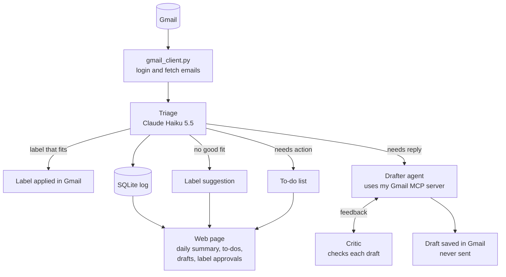

# Inbox Agent

An AI agent that organizes my Gmail. It sorts every email into labels, flags the emails that need a reply or an action from me, drafts replies, and shows everything on a web page with a daily summary. Several Claude models work together, each with its own job, and nothing is ever sent without my approval.

**Status:** Steps 1 to 3 done, including the triage upgrade. The agent reads my inbox, sorts each email with Claude Haiku, flags what needs a reply or an action, and suggests new labels for emails that fit none. It's still a dry run that changes nothing in Gmail. Step 4 is under way: the Label Designer suggested a label set, I reviewed it, and triage now sorts with those 11 labels. Next: applying the labels in Gmail.

## How it works



Built so far: `gmail_client.py`, Triage (dry run) and the Label Designer. Everything else is planned.

| Part | Model | Job |
|---|---|---|
| Triage | Claude Haiku 5.5 | Sorts each email, flags needs reply / needs action. Cheap and fast, because it runs on every email |
| Label Designer | Claude Opus 5.5 | Reads a few hundred emails and my existing labels, and suggests labels with descriptions. Runs rarely, so the best model is worth the cost |
| Drafter (planned) | Claude Sonnet 5.5 | An agent that looks up past emails with tools, then writes a reply |
| Critic (planned) | Claude Opus 5.5 | Checks each draft for made-up facts, promises I never made and wrong tone, and sends it back for changes |

## Design decisions

### Who decides what

The agent acts on its own when an action is low-risk and easy to undo. It needs my approval when an action changes how the whole system behaves, and it never does anything that can't be undone.

| Action | Who decides | Why |
|---|---|---|
| Apply a label | Agent alone | Affects one email, easy to undo |
| Flag "needs reply" or "needs action" | Agent alone | It's only information |
| Create a new label | Agent suggests, I approve | Changes how every future email is sorted |
| Draft a reply | Agent alone | It's only a draft |
| Send an email | Never the agent | Can't be undone |

**Why the agent doesn't create labels by itself:** it only sees one email at a time, but a good label covers a pattern across many emails. Letting it create labels freely would lead to near-duplicates ("Job Alerts", "Job Notifications"), each new label would change where future emails go, and anyone who emails me could influence my inbox's structure. Instead, emails that fit no label go to "Unsorted" with a suggested label. The web page groups similar suggestions, and I approve, edit or reject them.

### Safety

- **No send or delete tools.** The agent can label, flag and draft, nothing more. Even if an email tricks the model, it can't send or delete anything.
- **Prompt injection defense.** Anyone can email me, so email content is untrusted. The email goes inside `<email>` tags, and the prompt says to treat everything inside them as content, never as instructions. Triage also has no tools, so the worst a malicious email can do is get itself mislabeled.
- **Least privilege.** The app asks Google only for the permissions the current step needs. Right now that's read-only.
- **Secrets stay out of Git.** The API key (`.env`), the Google app file (`credentials.json`) and my saved login (`token.json`) are all in `.gitignore`.
- **Less data sent to the model.** Triage sends only the sender, subject and preview, not the full email.
- **Personal data stays out of Git.** The Label Designer's suggestions quote subjects from my real emails, and its label descriptions name companies I applied to, so `labels_proposed.json` is in `.gitignore`. The final label file will be handled the same way, with a shareable example file in the repo instead.

### Engineering choices

- **The right model for each job.** Haiku for high-volume sorting, stronger models only where judgment matters.
- **Structured outputs instead of parsing text.** Triage describes the answer it wants as a Pydantic class. The API forces Claude to answer in exactly that shape, and the label field only allows names from the label list, so Claude can't invent a label.
- **Workflow where possible, agent where needed.** In triage, my code decides every step and Claude makes one decision per email (a workflow). The Drafter will be a real agent that decides for itself which tools to use.
- **Gmail code separate from AI code.** All Gmail code is in `gmail_client.py`. That keeps the AI code simple, and it's what will become my Gmail MCP server.
- **My own MCP server instead of a ready-made one.** Community Gmail MCP servers usually include send and delete, and would mean trusting someone else's code with my inbox. My own server only has the tools I choose, and it also works in Claude Desktop.
- **Gmail filters and the agent work together.** My filters already sort job alerts by sender address. The agent catches the ones the filters miss by recognizing what an email is, not just who sent it.
- **Facts come from code, judgment comes from the model.** Anything the code can check for itself (like whether a label already exists in Gmail) is computed in code, not asked of the model. The model is only used for decisions that need judgment.
- **Label descriptions are the prompt.** The model only knows what a label means from its description, so fixing wrong labels usually means rewriting descriptions.
- **A log of every decision (planned).** A SQLite database will record what the agent did to each email. It means no email is processed twice, and it provides the daily summary, an undo for any label, and data for measuring accuracy.

## Progress log

### Step 1: First call to Claude
- **Built:** `hello_claude.py` sends Claude a sample email and asks for a category, whether it needs a reply, and why.
- **Learned:** what an API call contains (model, system prompt, messages, effort), why the reply comes as a list of blocks, and how tokens determine cost.
- **Result:** correct answer ("Friends, needs reply") for about $0.002.

### Step 2: Connect to Gmail
- **Built:** `gmail_client.py` holds all the Gmail code (login, fetching emails, converting them into a simple `Email` object). `show_inbox.py` prints the 20 newest inbox emails.
- **Learned:** how OAuth login works (my password never reaches the app; it gets an access token and a refresh token, saved in `token.json`), scopes, and the Gmail API's two-step pattern (list email IDs, then fetch each email's details).
- **Notes:** while the Google app is in testing mode, Google ends the login every 7 days. The code notices and opens the browser to sign in again.

### Step 3: Triage (dry run)
- **Built:** `triage.py` sorts the 20 newest emails into 7 starter labels with Claude Haiku 5.5, and flags which need a reply. It only prints the results.
- **Learned:** structured outputs with Pydantic, system prompts versus user messages, effort levels, and prompt injection.
- **Result:** 20 emails sorted for $0.0026, about 13 cents per 1,000 emails. Every label was sensible. None were marked as needing a reply, which is correct, because all 20 were automated emails.
- **Found:** two similar career-advice newsletters got different labels ("Job Alerts" and "Promotions"), because neither description said where newsletters belong. This led to the decision that label descriptions need care, and that the agent should suggest labels rather than create them.
- **Ideas from review:** a "needs action" flag for emails that need me to do something rather than reply (sign a contract, verify an account), and an "Unsorted" label with suggestions for emails that fit no label.

### Step 3b: Triage upgrade (needs action, Unsorted)
- **Built:** triage now also returns `needs_action` with a short to-do (`action`), and can choose "Unsorted" with a `suggested_label` and `suggested_description`. It prints a summary at the end (emails per label, how many need a reply or action), and `python triage.py 50` sorts more than 20 emails.
- **Learned:** optional fields in structured outputs (`str | None`), `Field` descriptions that act as instructions for each field, writing prompt rules for edge cases, and `if __name__ == "__main__"` so the web page can reuse `triage()` later.
- **Result:** on the 50 newest emails, all 8 real actions were found: a contract to sign (and its reminder), a Workday account to verify, and five LinkedIn messages from a recruiter. Two emails went to Unsorted with sensible suggestions: "University" (graduation ceremony) and "Social Notifications" (LinkedIn post reactions). Cost: $0.0111 for 50 emails, about 22 cents per 1,000. That's up from 13 cents because the prompt and the answer are longer.
- **Found:**
  - A first test gave inconsistent results for LinkedIn "X just messaged you" emails: one marked as needing a reply, two marked as nothing. These are automated notifications, and the reply happens on LinkedIn, not by email. A new prompt rule fixed it: a message from a real person on another site counts as an **action** (reply on that site), not an email reply. After the fix, all five were consistent.
  - LinkedIn sent five separate notifications for the same conversation, which gave five identical to-dos. The web page should group to-dos from the same conversation.
  - Career newsletters are still split between "Job Alerts" and "Promotions". That gets fixed with label descriptions in Step 4.

### Step 4a: Label Designer
- **Built:** `label_designer.py` reads the 200 newest inbox emails plus 5 examples from each label I made in Gmail, and asks Claude Opus 5.5 (effort high) to design a label set. It saves the suggestion to `labels_proposed.json` for me to review, and prints it with example emails for each label and notes on decisions I should check. `gmail_client.py` gained `list_labels()`, and `list_recent_emails()` can now read any label, not just the inbox.
- **Learned:** streaming (receiving a long answer piece by piece so the connection doesn't time out), giving each email a number so the model can point to examples instead of copying them, and asking the model to list its own uncertain decisions.
- **Result:** 12 suggested labels for $0.32, read from 210 emails. They include my LinkedIn and Indeed alert labels, plus Applications, LinkedIn Updates, University, Events, Orders & Payments, Security & Logins, Promotions and a "Job Alerts" label for other job boards. The descriptions are specific: they name typical senders and say where borderline emails go, such as career newsletters and job-application login codes.
- **Found:**
  - **The model got a fact wrong.** It marked "Job Alerts" as one of my existing labels, but no such label exists. Fix: the code now checks this itself against the real Gmail labels.
  - **Labels made by a mail app.** Gmail has two labels I didn't make myself, `[Imap]/Drafts` and `Junk Email`, probably created when my Gmail was connected to a mail app like Outlook. Both are empty. Because the prompt said to keep every existing label, the model invented new meanings for them. They should be left out.
  - **No "Personal" label.** The sample had almost no emails from real people, so the model didn't create one. But emails from real people are rare and important, so a Personal label is probably still worth having.
  - **The descriptions contain personal details:** companies I applied to and a recruiter's name. That's why the label files stay out of Git.

### Step 4b: Final labels, and triage uses them
- **Decided:** left out `[Imap]/Drafts` and `Junk Email`, so Sovendus voucher mail goes to Promotions. Kept a separate "Job Alerts" label for job boards other than LinkedIn and Indeed. Kept LinkedIn messages from real people in "LinkedIn Updates", because they already appear on the to-do list. Added a "Personal" label for emails from people I know.
- **Built:** `labels.json` holds my 11 final labels with their descriptions. It's kept out of Git, and `labels.example.json` is a shareable version with generic descriptions. `triage.py` now reads its labels from `labels.json`, or from the example file if there's none yet, so nothing about my labels is hard-coded anymore.
- **Result:** on the 50 newest emails:
  - **No email went to Unsorted.** In the last run, two did, and both now have a label (University, and LinkedIn Updates).
  - **Career newsletters are now consistent.** Each one follows the rule in its label's description: LinkedIn's goes to LinkedIn Updates, Indeed's tips go to Indeed Alerts, and the university career portal goes to University.
  - **All 8 actions were found again:** 3 contract-signing emails and 5 LinkedIn messages.
  - **Cost:** $0.0173, or about 35 cents per 1,000 emails. That's up from 22 cents, because the longer label descriptions are sent with every email.
- **Learned:** keeping settings in a data file instead of in code, and the `.env` / `.env.example` pattern applied to personal data (a private file plus a shareable example).
- **Idea:** triage sends the same system prompt with every email, so prompt caching (a discount for repeating the same text) could cut the cost. Worth checking whether the prompt is long enough to qualify.

## What's left

- [x] **Step 1:** First call to Claude
- [x] **Step 2:** Connect to Gmail
- [x] **Step 3:** Triage (dry run)
- [x] **Triage upgrade:** `needs_action` with what to do, and "Unsorted" with a suggested label name and description
- [x] **Step 4a:** Label Designer reads my existing labels and inbox and suggests a label set
- [x] **Step 4b:** review the suggestion, save the final labels in `labels.json` (kept out of Git, with a `labels.example.json` in the repo), and make triage read its labels from that file
- [ ] **Step 4c:** apply labels in Gmail (this needs permission to change labels, so I'll sign in again) and log every decision in SQLite
- [ ] **Step 5:** my own Gmail MCP server, with tools to read emails and save drafts but none to send or delete. Test it in Claude Desktop
- [ ] **Step 6:** the Drafter agent and the Critic
- [ ] **Step 7:** web page with a daily summary, to-do list, drafted replies and label suggestions, and a way to run the agent every day. Group to-dos that come from the same conversation
- [ ] **Step 8:** accuracy tests (evals), README polish and a demo video
- [ ] **Cost:** try prompt caching for triage's system prompt, which is the same for every email

**Open questions**
- Should the daily run happen automatically each morning (Windows Task Scheduler) or when I open the web page?

## Project files

| File | What it does |
|---|---|
| `hello_claude.py` | Step 1: first call to Claude |
| `gmail_client.py` | All Gmail code: login, fetch emails |
| `show_inbox.py` | Step 2: prints the 20 newest inbox emails |
| `triage.py` | Step 3: sorts emails with Claude Haiku, flags replies and actions, suggests labels (dry run) |
| `label_designer.py` | Step 4: Claude Opus suggests a label set from my inbox and existing labels |
| `labels.example.json` | A shareable example label set. My real labels are in `labels.json`, which isn't in Git |
| `requirements.txt` | Python packages, with exact versions |
| `.env.example` | Template for the API key file |

Not in Git: `.env` (API key), `credentials.json` (Google app file), `token.json` (saved Gmail login), `labels_proposed.json` (label suggestions that quote my real emails), `labels.json` (my labels, whose descriptions name companies I applied to), `.venv/` (Python environment).

## Setup

1. Install Python 3.13.
2. Create a virtual environment and install the dependencies:
   ```
   py -3.13 -m venv .venv
   .venv\Scripts\activate
   pip install -r requirements.txt
   ```
3. Copy `.env.example` to `.env` and paste in your API key from the Claude Console.
4. In Google Cloud Console, turn on the Gmail API, set up the OAuth consent screen with yourself as a test user, and create a **Desktop app** OAuth client. Save its JSON file as `credentials.json` in the project folder.
5. Run `python hello_claude.py` to check the Claude connection.
6. Run `python show_inbox.py` to sign in to Gmail and list your 20 newest emails.
7. Run `python triage.py` to see which label Claude would give each of your 20 newest emails, which ones need a reply or an action, and which fit no label. Add a number to sort more, for example `python triage.py 50`. Nothing in Gmail changes.
8. Run `python label_designer.py` to have Claude Opus suggest a label set from your 200 newest inbox emails and your existing Gmail labels (about $0.30). It saves the suggestion to `labels_proposed.json`. Nothing in Gmail changes. Review it, then save the labels you want to keep as `labels.json`, in the same format as `labels.example.json`. Until you do, triage uses the example labels.
