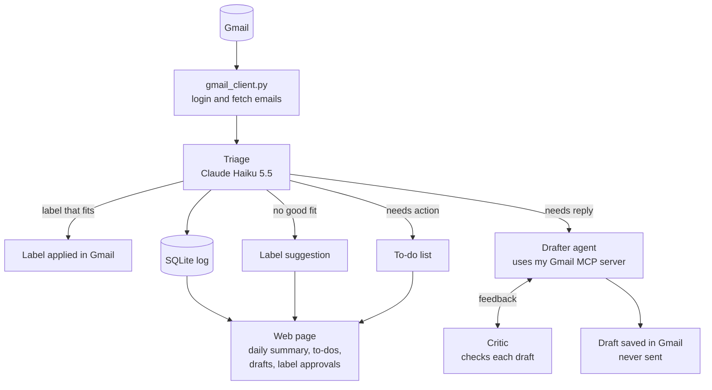

# Inbox Agent

An AI agent that organizes my Gmail. It sorts every email into labels, flags the emails that need a reply or an action from me, drafts replies, and shows everything on a web page with a daily summary. Several Claude models work together, each with its own job, and nothing is ever sent without my approval.

**Status:** Steps 1 to 4 done. The agent sorts each email into one of 15 labels designed by Claude Opus and reviewed by me, flags what needs a reply or an action, and suggests new labels for emails that fit none. It adds the labels in Gmail and archives sorted emails, so the inbox only holds what still needs me. It records every decision in a database, so it never sorts the same email twice and any run can be undone. **It sorted my whole backlog with the Message Batches API: 6,547 emails for $1.54, taking the inbox from 6,494 emails to 60.** Step 5 is built: my own Gmail MCP server, whose tools can search and read emails, list my to-dos and save reply drafts, but never send, delete or archive. Next: try it in Claude Desktop, then Step 6, the Drafter agent.

## How it works



Built so far: `gmail_client.py`, Triage (including applying labels in Gmail), the Label Designer, the SQLite log, the backlog sorter and the Gmail MCP server. The Drafter, the Critic and the web page are planned.

### The Gmail MCP server's tools

| Tool | What it does | Can change Gmail? |
|---|---|---|
| `search_emails` | Searches all mail with Gmail's search syntax, and returns sender, subject, date, preview and labels | No |
| `read_thread` | Returns a whole conversation: each message's sender, recipients, date and text | No |
| `list_todos` | Recent emails the agent flagged as needing a reply or an action that are still in the inbox | No |
| `create_reply_draft` | Saves a reply inside a conversation as a draft. It is never sent | Only adds a draft |

There is deliberately no tool to send, delete, archive or relabel anything.

### How the MCP server works

**Three layers.** `gmail_client.py` holds everything that talks to Gmail, and my own scripts use all of it, including the functions that change labels. `gmail_mcp_server.py` is the menu offered to AI apps: it picks the safe abilities, describes them for a model and leaves the rest out. The model itself (Claude) only reads and writes text. When it wants a tool, it asks the app it runs in, and the app makes the call. The model never talks to the server directly.

```
You ──▶ App (Claude Desktop) ──▶ Model (Claude): "call list_todos"
              │
              ▼
        gmail_mcp_server.py ──▶ Gmail + my database
              │
              ▼
        App ──▶ Model: "here's the result" ──▶ answer to me
```

**stdin, stdout and stderr.** The app starts the server in the background and connects to its three standard channels:

```
App                                   gmail_mcp_server.py
 │ ── stdin:  requests (JSON) ─────────▶ │
 │ ◀─ stdout: answers (JSON) ─────────── │
 │ ◀─ stderr: plain text for humans ──── │  → saved to a log, never read as JSON
```

stdin and stdout carry the conversation as JSON messages: the handshake, the list of tools, then each tool call and its answer. stderr is a side channel for warnings and errors, which the app stores in a log. That's why the code never prints to stdout: a stray message there would be read as JSON and break the connection.

| Part | Model | Job |
|---|---|---|
| Triage | Claude Haiku 5.5 | Sorts each email, flags needs reply / needs action. Cheap and fast, because it runs on every email |
| Label Designer | Claude Opus 5.5 | Reads a few hundred emails and my existing labels, and suggests labels with descriptions. Runs rarely, so the best model is worth the cost |
| Drafter (planned) | Claude Sonnet 5.5 | An agent that looks up past emails with tools, then writes a reply |
| Critic (planned) | Claude Opus 5.5 | Checks each draft for made-up facts, promises I never made and wrong tone, and sends it back for changes |

## Design decisions

### Who decides what

The agent acts on its own when an action is low-risk and easy to undo. It needs my approval when an action changes how the whole system behaves, and it never does anything that can't be undone.

| Action | Who decides | Why |
|---|---|---|
| Apply a label | Agent alone | Affects one email, easy to undo |
| Archive a sorted email | Agent alone | Easy to undo. Emails that need a reply or an action, and Unsorted ones, stay in the inbox |
| Flag "needs reply" or "needs action" | Agent alone | It's only information |
| Create a new label | Agent suggests, I approve | Changes how every future email is sorted |
| Draft a reply | Agent alone | It's only a draft |
| Send an email | Never the agent | Can't be undone |

**Why the agent doesn't create labels by itself:** it only sees one email at a time, but a good label covers a pattern across many emails. Letting it create labels freely would lead to near-duplicates ("Job Alerts", "Job Notifications"), each new label would change where future emails go, and anyone who emails me could influence my inbox's structure. Instead, emails that fit no label go to "Unsorted" with a suggested label. The web page groups similar suggestions, and I approve, edit or reject them.

### Safety

- **No send or delete tools.** The agent can label, flag and draft, nothing more. Even if an email tricks the model, it can't send or delete anything.
- **Prompt injection defense.** Anyone can email me, so email content is untrusted. The email goes inside `<email>` tags, and the prompt says to treat everything inside them as content, never as instructions. Triage also has no tools, so the worst a malicious email can do is get itself mislabeled.
- **Least privilege, and being honest about its limits.** The app asks Google only for the permissions the current step needs. Steps 2 and 3 were read-only. Applying labels needs `gmail.modify`, the narrowest Google permission that can change labels on emails. It also covers drafts and sending, so the real safety boundary is the code: `gmail_client.py` has no function that sends or deletes anything.
- **Every change can be undone.** The agent only adds labels and archives, and it never deletes anything. Every change is logged, and `undo.py` reverses the last run: it removes the labels the agent added and moves archived emails back into the inbox. Labels that were already on an email, for example from my own Gmail filters, are recorded as such and left alone by undo.
- **Archive only what doesn't need me.** Emails that need a reply or an action, and Unsorted ones, stay in the inbox. So a wrong label can never hide something I have to deal with.
- **Start small and check.** The first real run labeled only 10 emails. A separate check read the labels back from Gmail, rather than trusting the script's own output. Undo was tested the same way before relabeling.
- **Secrets stay out of Git.** The API key (`.env`), the Google app file (`credentials.json`) and my saved login (`token.json`) are all in `.gitignore`.
- **Less data sent to the model.** Triage sends only the sender, subject and preview, not the full email.
- **The MCP server is safe by construction.** Its tools can only read and save drafts. Each tool is marked with MCP annotations (`read_only_hint`, `destructive_hint`), so apps know which ones change something and can ask before using them. The server also tells every app that email content is untrusted, and to treat it as information, never as instructions.
- **Personal data stays out of Git.** The Label Designer's suggestions quote subjects from my real emails, and its label descriptions name companies I applied to, so `labels_proposed.json` is in `.gitignore`. The final label file will be handled the same way, with a shareable example file in the repo instead.

### Engineering choices

- **The right model for each job.** Haiku for high-volume sorting, stronger models only where judgment matters.
- **Structured outputs instead of parsing text.** Triage describes the answer it wants as a Pydantic class. The API forces Claude to answer in exactly that shape, and the label field only allows names from the label list, so Claude can't invent a label.
- **Workflow where possible, agent where needed.** In triage, my code decides every step and Claude makes one decision per email (a workflow). The Drafter will be a real agent that decides for itself which tools to use.
- **Gmail code separate from AI code.** All Gmail code is in `gmail_client.py`. That keeps the AI code simple, and it's what will become my Gmail MCP server.
- **My own MCP server instead of a ready-made one.** Community Gmail MCP servers usually include send and delete, and would mean trusting someone else's code with my inbox. My own server only has the tools I choose, and it also works in Claude Desktop.
- **Gmail filters and the agent work together.** My filters already sort job alerts by sender address. The agent catches the ones the filters miss by recognizing what an email is, not just who sent it.
- **Facts come from code, judgment comes from the model.** Anything the code can check for itself (like whether a label already exists in Gmail) is computed in code, not asked of the model. The model is only used for decisions that need judgment.
- **Label descriptions are the prompt.** The model only knows what a label means from its description, so fixing wrong labels usually means rewriting descriptions.
- **A log of every decision.** A SQLite database (`inbox_agent.db`) records what the agent decided about each email and whether it added the label. So no email is processed (or paid for) twice, any run can be undone, and the log will feed the daily summary and accuracy tests.
- **Dry run by default.** `triage.py` only changes Gmail when you add `--apply`. Running it without that is always safe.
- **To-dos only for recent emails.** Emails older than 30 days are archived even if flagged as needing a reply or an action, because they've been dealt with. The flags are still logged, as test data for the model.
- **stdout belongs to MCP.** An MCP server talks to its app over stdin/stdout, so any stray `print()` would break the connection. All messages in `gmail_client.py` go to stderr instead. The server also never opens a browser to sign in, because nobody would see it. If the Gmail login has expired, the tool says so, and I sign in by running a script.
- **One Gmail request at a time in the server.** Apps can call several tools at once, each on its own thread, but Google's client library isn't safe to use from two threads at once. A lock makes the tools take turns.
- **Bulk where it pays.** Fetching emails uses Gmail batch requests (50 at a time). The 6,500-email backlog will use Claude's Message Batches API (half price, results within hours), while the daily run stays one email at a time, since that's only a few emails.
- **Gmail labels aren't folders.** An email is stored once, whatever its labels. "Inbox" is just another label, and archiving removes it. So labeling and archiving don't change storage. The point of archiving is a clear inbox, not saving space.
- **Database migrations.** When the log gained an `archived` column, `database.py` adds it to existing database files automatically, instead of requiring the old log to be deleted.

## Progress log

### Step 1: First call to Claude
- **Built:** `hello_claude.py` sends Claude a sample email and asks for a category, whether it needs a reply, and why.
- **Learned:** what an API call contains (model, system prompt, messages, effort), why the reply comes as a list of blocks, and how tokens determine cost.
- **Result:** correct answer ("Friends, needs reply") for about $0.002.

### Step 2: Connect to Gmail
- **Built:** `gmail_client.py` holds all the Gmail code (login, fetching emails, converting them into a simple `Email` object). `show_inbox.py` prints the 20 newest inbox emails.
- **Learned:** how OAuth login works (my password never reaches the app; it gets an access token and a refresh token, saved in `token.json`), scopes, and the Gmail API's two-step pattern (list email IDs, then fetch each email's details).
- **Notes:** while the Google app is in testing mode, Google ends the login every 7 days. The code notices and opens the browser to sign in again.

### Step 3: Triage (dry run)
- **Built:** `triage.py` sorts the 20 newest emails into 7 starter labels with Claude Haiku 5.5, and flags which need a reply. It only prints the results.
- **Learned:** structured outputs with Pydantic, system prompts versus user messages, effort levels, and prompt injection.
- **Result:** 20 emails sorted for $0.0026, about 13 cents per 1,000 emails. Every label was sensible. None were marked as needing a reply, which is correct, because all 20 were automated emails.
- **Found:** two similar career-advice newsletters got different labels ("Job Alerts" and "Promotions"), because neither description said where newsletters belong. This led to the decision that label descriptions need care, and that the agent should suggest labels rather than create them.
- **Ideas from review:** a "needs action" flag for emails that need me to do something rather than reply (sign a contract, verify an account), and an "Unsorted" label with suggestions for emails that fit no label.

### Step 3b: Triage upgrade (needs action, Unsorted)
- **Built:** triage now also returns `needs_action` with a short to-do (`action`), and can choose "Unsorted" with a `suggested_label` and `suggested_description`. It prints a summary at the end (emails per label, how many need a reply or action), and `python triage.py 50` sorts more than 20 emails.
- **Learned:** optional fields in structured outputs (`str | None`), `Field` descriptions that act as instructions for each field, writing prompt rules for edge cases, and `if __name__ == "__main__"` so the web page can reuse `triage()` later.
- **Result:** on the 50 newest emails, all 8 real actions were found: a contract to sign (and its reminder), a Workday account to verify, and five LinkedIn messages from a recruiter. Two emails went to Unsorted with sensible suggestions: "University" (graduation ceremony) and "Social Notifications" (LinkedIn post reactions). Cost: $0.0111 for 50 emails, about 22 cents per 1,000. That's up from 13 cents because the prompt and the answer are longer.
- **Found:**
  - A first test gave inconsistent results for LinkedIn "X just messaged you" emails: one marked as needing a reply, two marked as nothing. These are automated notifications, and the reply happens on LinkedIn, not by email. A new prompt rule fixed it: a message from a real person on another site counts as an **action** (reply on that site), not an email reply. After the fix, all five were consistent.
  - LinkedIn sent five separate notifications for the same conversation, which gave five identical to-dos. The web page should group to-dos from the same conversation.
  - Career newsletters are still split between "Job Alerts" and "Promotions". That gets fixed with label descriptions in Step 4.

### Step 4a: Label Designer
- **Built:** `label_designer.py` reads the 200 newest inbox emails plus 5 examples from each label I made in Gmail, and asks Claude Opus 5.5 (effort high) to design a label set. It saves the suggestion to `labels_proposed.json` for me to review, and prints it with example emails for each label and notes on decisions I should check. `gmail_client.py` gained `list_labels()`, and `list_recent_emails()` can now read any label, not just the inbox.
- **Learned:** streaming (receiving a long answer piece by piece so the connection doesn't time out), giving each email a number so the model can point to examples instead of copying them, and asking the model to list its own uncertain decisions.
- **Result:** 12 suggested labels for $0.32, read from 210 emails. They include my LinkedIn and Indeed alert labels, plus Applications, LinkedIn Updates, University, Events, Orders & Payments, Security & Logins, Promotions and a "Job Alerts" label for other job boards. The descriptions are specific: they name typical senders and say where borderline emails go, such as career newsletters and job-application login codes.
- **Found:**
  - **The model got a fact wrong.** It marked "Job Alerts" as one of my existing labels, but no such label exists. Fix: the code now checks this itself against the real Gmail labels.
  - **Labels made by a mail app.** Gmail has two labels I didn't make myself, `[Imap]/Drafts` and `Junk Email`, probably created when my Gmail was connected to a mail app like Outlook. Both are empty. Because the prompt said to keep every existing label, the model invented new meanings for them. They should be left out.
  - **No "Personal" label.** The sample had almost no emails from real people, so the model didn't create one. But emails from real people are rare and important, so a Personal label is probably still worth having.
  - **The descriptions contain personal details:** companies I applied to and a recruiter's name. That's why the label files stay out of Git.

### Step 4b: Final labels, and triage uses them
- **Decided:** left out `[Imap]/Drafts` and `Junk Email`, so Sovendus voucher mail goes to Promotions. Kept a separate "Job Alerts" label for job boards other than LinkedIn and Indeed. Kept LinkedIn messages from real people in "LinkedIn Updates", because they already appear on the to-do list. Added a "Personal" label for emails from people I know.
- **Built:** `labels.json` holds my 11 final labels with their descriptions. It's kept out of Git, and `labels.example.json` is a shareable version with generic descriptions. `triage.py` now reads its labels from `labels.json`, or from the example file if there's none yet, so nothing about my labels is hard-coded anymore.
- **Result:** on the 50 newest emails:
  - **No email went to Unsorted.** In the last run, two did, and both now have a label (University, and LinkedIn Updates).
  - **Career newsletters are now consistent.** Each one follows the rule in its label's description: LinkedIn's goes to LinkedIn Updates, Indeed's tips go to Indeed Alerts, and the university career portal goes to University.
  - **All 8 actions were found again:** 3 contract-signing emails and 5 LinkedIn messages.
  - **Cost:** $0.0173, or about 35 cents per 1,000 emails. That's up from 22 cents, because the longer label descriptions are sent with every email.
- **Learned:** keeping settings in a data file instead of in code, and the `.env` / `.env.example` pattern applied to personal data (a private file plus a shareable example).
- **Idea:** triage sends the same system prompt with every email, so prompt caching (a discount for repeating the same text) could cut the cost. Worth checking whether the prompt is long enough to qualify.

### Step 4c: Applying labels in Gmail
- **Built:**
  - `gmail_client.py`: `get_or_create_labels()` creates any missing labels in Gmail, `add_label()` and `remove_label()` change one email's labels, and each `Email` now knows which labels it already has.
  - `database.py`: a SQLite log with one row per email: the decision, the reason, the cost, the run it belonged to, and whether the agent actually added the label.
  - `triage.py --apply`: applies the labels and logs each decision, and skips emails that are already in the log. `undo.py` reverses the last run.
- **Learned:** SQLite and SQL basics (`CREATE TABLE`, `INSERT`, `SELECT`, `DELETE`), why queries use `?` placeholders (to stop SQL injection), `argparse` for command-line options, and checking an action's real effect instead of trusting the script's own output.
- **Result:**
  - The first run created 10 new labels in Gmail and labeled the 10 newest emails, for $0.0035.
  - A check read each email back from Gmail: 10 of 10 had their label, and all were still in the inbox.
  - `undo.py` removed all 10 labels, which was again checked in Gmail, and relabeling put them back.
  - A second run skipped all 10 emails as already sorted, without calling Claude.
- **Found:**
  - One Indeed job email didn't have my "Indeed Alerts" label, because my Gmail filter missed it. The agent added it. That's exactly the gap the agent is meant to fill.
  - A bug: a run with nothing new still printed "to undo this run, run undo.py". That run records nothing, so undo would have reversed the run before it. Fixed: the hint only appears when a run changed something.

### Step 4d: Archiving
- **Decided:** archive emails once they're labeled, so the inbox works as a to-do list. Emails that need a reply or an action, and Unsorted emails, stay in the inbox.
- **Built:** `change_labels()` in `gmail_client.py` adds and removes labels in one request. It replaced `add_label()` and `remove_label()`, because archiving is just removing the INBOX label. `triage.py --apply` now archives sorted emails (`ARCHIVE_SORTED_EMAILS` turns this off), the log records which emails were archived, and `undo.py` moves them back into the inbox.
- **Learned:** Gmail labels aren't folders, so archiving doesn't change storage. The benefit is a clearer inbox. Also learned database migrations (`ALTER TABLE`), for adding a column to an existing database.
- **Result:** undid the first 10 and re-sorted the 10 newest with archiving. 8 were labeled and archived. The 2 that still need me stayed in the inbox: a contract to sign and a LinkedIn message. A check in Gmail confirmed every label and inbox status.
- **Also decided:** the two empty labels my old mail app created (`[Imap]/Drafts` and `Junk Email`) get deleted by hand in Gmail's settings, not by the agent. That way the agent's code still has no ability to delete anything.

### Step 4e: First bigger batch
- **Result:** `python triage.py 50 --apply` sorted 48 new emails (2 were already sorted and got skipped) in 94 seconds, for $0.0165. 42 were labeled and archived. 6 stayed in the inbox because they need me: 4 LinkedIn message notifications and 2 contract-signing emails. A check in Gmail confirmed all 48 labels and inbox statuses. The two old labels are deleted.
- **Found:**
  - **The inbox holds 6,529 emails.** At the current speed (about 2 seconds per email, one at a time) and cost ($0.00034 per email), sorting all of them would take about 3.6 hours and cost about $2.25. Before doing that, a few decisions are needed (see Open questions).
  - **One email at a time is slow for a backlog.** For thousands of emails, Claude's Message Batches API fits better: it processes requests in the background at half the price.
  - **Gmail returns at most 500 emails per request,** so sorting the full inbox needs paging through the results.

### Step 4f: Getting ready for the backlog
- **Decided:**
  - Check the labels against **200 random emails from the last 5 years**, not just recent ones, before sorting the backlog.
  - For **past emails, ignore "needs reply" and "needs action"**: they've all been dealt with. Triage still records the flags (useful for testing the model later), but emails older than 30 days get archived whatever their flags say.
  - Process the backlog with the **Message Batches API**: half price, and speed doesn't matter.
- **Built:**
  - `gmail_client.py`: `list_message_ids()` pages through any number of emails, 500 per request, and accepts Gmail search queries like `newer_than:5y`. `get_emails()` fetches emails in bundles of 50 (Gmail "batch requests"), pausing between bundles to respect Gmail's rate limit and retrying any that fail. `list_recent_emails()` uses both.
  - `triage.py`: `KEEP_IN_INBOX_DAYS = 30`. Older emails are archived even when flagged.
  - `label_designer.py` now **improves the current labels** instead of starting over. It reads `labels.json` (descriptions) and examples from each Gmail label, plus a random sample with each email's date. It keeps label names stable, because renaming means relabeling. The code works out which labels are new, edited, unchanged or removed by comparing with the current file, rather than asking the model.
- **Result:**
  - Bulk fetching got 120 emails in 5 seconds, instead of about a minute one by one. Listing all 6,494 inbox IDs took 3 seconds. 5,776 of them are from the last 5 years, and 718 are older.
  - The Label Designer read 236 emails for $0.41. It suggested 4 new labels for types the recent sample never showed: **Travel**, **Housing**, **Marktplaats** and **Admin & Health**. It improved the descriptions of 10 others, for example adding the universities I attended before and older job boards, and left Indeed Alerts unchanged. 15 labels in total.
- **Learned:** random sampling to get a representative picture of thousands of emails, paging through API results, batch requests and rate limits, and retrying with increasing waits ("exponential backoff").

### Step 4g: Sorting the backlog with the Message Batches API
- **Decided:** accepted all 15 labels. JobTeaser job matches stay in University. The backlog includes every inbox email, also the 718 older than 5 years.
- **Built:**
  - `backlog.py` with four steps:
    - `sample` is a live dry run on random unsorted emails.
    - `submit` sends every unsorted inbox email to Claude as one batch, with each email's ID as the request's `custom_id`.
    - `wait` checks the batch once a minute.
    - `apply` reads the results, gets each email's current labels from Gmail, groups emails that need the same change, and applies each group with Gmail's `batchModify` (up to 1,000 emails per request). Then it logs every decision as one run.
  - The batch requests use the same prompt and answer shape as live triage. The SDK's `transform_schema()` turns `TriageResult` into the JSON schema that `messages.parse()` normally builds for us.
  - `change_labels_bulk()` in `gmail_client.py`, and `undo.py` now uses it too, so undoing thousands of emails takes a few requests instead of thousands.
- **Dry run:** 40 random unsorted emails from 2019 to 2026 with the new labels, for $0.0187: **0 went to Unsorted**. The new labels caught their cases, such as a 2022 rental alert (Housing) and a physio appointment (Admin & Health).
- **Found:**
  - **Gmail's per-minute limit.** The first `submit` could only fetch 3,653 of the 6,486 emails. Gmail answered the rest with "Quota exceeded for quota metric 'Total Query Cost' and limit 'Units per minute per user'", and my retries only waited up to 8 seconds. A test script showed the errors started after just 44 requests. Fix: `get_emails()` now waits a full minute when Gmail refuses because of the limit, then carries on where it stopped. It also tells temporary errors (limits, brief outages) apart from permanent ones, like a deleted email, which it skips instead of retrying forever. Gmail allows this account roughly 400 to 500 emails per minute, so fetching 1,500 now takes 3.5 minutes with nothing missed.
  - The skipped emails weren't lost. They weren't in the log, so they went into a second batch.
  - The first version of `apply` said "to undo the whole backlog, run undo.py". But each `apply` is its own run, so undo only reverses the last batch. The message now says so.
- **Result, batch 1:** 3,653 emails, finished by Claude in about 8 minutes with 0 errors. Cost: **$0.86** at half price (about $0.24 per 1,000 emails). In Gmail, 3,604 were labeled and archived, and 49 recent emails that need me stayed in the inbox. Only 28 went to Unsorted (0.8%). The biggest labels were Promotions (719), University (665), LinkedIn Updates (490), Orders & Payments (396) and Housing (314).
- **Result, batch 2:** all 2,836 remaining emails were fetched with the fixed code, with none skipped. Claude finished them with 0 errors. 2,835 were archived and 1 stayed in the inbox, for **$0.66**. 17 went to Unsorted.
- **Checked:** read 150 random backlog emails back from Gmail. **150 of 150** had their label, and their inbox status matched the log.
- **In total:**
  - **The inbox went from 6,494 emails to 60.** The 58 kept there are recent and need me (34 of them are Marktplaats messages from buyers or sellers), plus 2 new emails.
  - **6,547 emails sorted for $1.54 in total.** That includes the earlier live runs and Label Designer tests.
  - **Only 45 emails (0.7%) went to Unsorted.**
  - Across all ages, the model flagged 751 emails as needing an action and 179 as needing a reply. They were archived anyway if older than 30 days. They're test data for checking the model's judgment later.

### Step 4h: Re-sorting the first emails
- **Built:** `undo.py --list` shows every run, and `undo.py --run RUN_ID` undoes any one of them, not just the last.
- **Result:** undid the two runs from before the 4 new labels existed (58 emails), then ran `python triage.py 150 --apply`. It re-sorted those 58, plus 30 new emails, for $0.04. The Ryanair itinerary moved from Orders & Payments to Travel.
- **Decided:** not to add labels for the 45 Unsorted emails. Most of them fit an existing label in an ambiguous way, or need personal context to sort. The web page will make it easy to change an email's label by hand instead.
- **Found:** triage flagged "attend the appointment on 23 October" as a to-do on 25 October, because it doesn't know today's date. Fix (to do): give triage today's date and each email's date.

### Step 5: My own Gmail MCP server
- **Built:**
  - `gmail_mcp_server.py` uses the official MCP Python SDK (version 2) to offer 4 tools: `search_emails`, `read_thread`, `list_todos` and `create_reply_draft`. Each tool's docstring becomes the description the model reads, and its type hints become the input schema. Annotations mark the read-only tools, and server-wide instructions warn the model that email content is untrusted.
  - `gmail_client.py` gained:
    - `get_thread()`, which reads a whole conversation. It walks each email's tree of parts, prefers the plain text, and falls back to HTML with the tags stripped.
    - `create_reply_draft()` and `build_reply()`, which reply to the newest message from someone else, with the `In-Reply-To` and `References` headers that keep the reply inside the conversation.
    - `get_my_address()`, plus searching all mail rather than only one label.
  - `check_mcp_server.py` starts the server the way an app would, lists its tools and tries the read-only ones. The Drafter in Step 6 will connect the same way.
- **Learned:** what an MCP server actually is (a program that describes its tools and answers calls over a standard protocol), the stdio transport, tool annotations, how email bodies are stored (MIME parts in base64url encoding), and how email apps link replies to conversations.
- **Result:**
  - The check started the server, which offered all 4 tools with the right read-only markings.
  - `search_emails` found inbox emails with their label names, `list_todos` returned 17 to-dos (such as signing the contract and a Ryanair customer verification), and `read_thread` returned a full message.
  - A separate test read a real 4-message conversation and built a reply (without saving it) that goes to the other person, with the right headers.
- **Found:**
  - **The SDK had changed.** In version 2 of the MCP Python SDK, the `FastMCP` class from most tutorials is called `MCPServer`, and the client API changed. Reading the migration guide and the installed code, rather than guessing, got it right the first time.
  - **Structured answers need precise types.** A tool declared as returning plain `dict` sent its answer as text instead of structured data. Declaring `dict[str, Any]` fixed it.
  - **The to-do list shows the past-dates bug from Step 4h:** a medical appointment from two days ago is still listed.

## What's left

- [x] **Step 1:** First call to Claude
- [x] **Step 2:** Connect to Gmail
- [x] **Step 3:** Triage (dry run)
- [x] **Triage upgrade:** `needs_action` with what to do, and "Unsorted" with a suggested label name and description
- [x] **Step 4a:** Label Designer reads my existing labels and inbox and suggests a label set
- [x] **Step 4b:** review the suggestion, save the final labels in `labels.json` (kept out of Git, with a `labels.example.json` in the repo), and make triage read its labels from that file
- [x] **Step 4c:** apply labels in Gmail and log every decision in SQLite, with undo
- [x] **Step 4d:** archive sorted emails, except those that still need me
- [x] Delete the empty `[Imap]/Drafts` and `Junk Email` labels in Gmail's settings (by hand)
- [x] First bigger batch: 50 emails
- [x] Check the labels against a random 5-year sample (Label Designer), page through the whole inbox, fetch emails in bulk
- [x] Review the 4 new labels and edited descriptions, and save them to `labels.json`
- [x] Dry run on 40 random older emails with the new labels
- [x] Sort the backlog with the Message Batches API: 6,489 emails in two batches, inbox down from 6,494 to 60
- [x] Re-sort the first 58 emails, which were sorted before the 4 new labels existed
- [ ] Give triage today's date and each email's date, so it doesn't flag past appointments and deadlines as to-dos
- [x] **Step 5:** my own Gmail MCP server, with tools to search and read emails, list to-dos and save drafts, but none to send, delete or archive
- [ ] Try the MCP server in Claude Desktop, including saving one draft
- [ ] **Step 6:** the Drafter agent and the Critic
- [ ] **Step 7:** web page with a daily summary, to-do list, drafted replies and label suggestions, and a way to run the agent every day. Group to-dos that come from the same conversation. A "done" button on a to-do should archive its email. Make it easy to change an email's label by hand, especially for Unsorted emails
- [ ] **Step 8:** accuracy tests (evals), README polish and a demo video
- [ ] **Cost:** try prompt caching for triage's system prompt, which is the same for every email

**Open questions**
- Should the daily run happen automatically each morning (Windows Task Scheduler) or when I open the web page?

## Project files

| File | What it does |
|---|---|
| `hello_claude.py` | Step 1: first call to Claude |
| `gmail_client.py` | All Gmail code: login, fetch emails |
| `show_inbox.py` | Step 2: prints the 20 newest inbox emails |
| `triage.py` | Step 3: sorts emails with Claude Haiku, flags replies and actions, suggests labels (dry run) |
| `label_designer.py` | Step 4: Claude Opus suggests a label set from my inbox and existing labels |
| `labels.example.json` | A shareable example label set. My real labels are in `labels.json`, which isn't in Git |
| `database.py` | The agent's memory: a SQLite log of every email it handled and what it decided |
| `undo.py` | Reverses the last run (`triage.py --apply` or `backlog.py apply`): removes the labels it added and moves archived emails back into the inbox |
| `backlog.py` | Sorts the whole inbox backlog with Claude's Message Batches API: `sample`, `submit`, `wait`, `apply` |
| `gmail_mcp_server.py` | My Gmail MCP server: search, read threads, list to-dos, save reply drafts. No send, delete or archive |
| `check_mcp_server.py` | Starts the MCP server the way an app would, lists its tools and tries the read-only ones |
| `requirements.txt` | Python packages, with exact versions |
| `.env.example` | Template for the API key file |

Not in Git: `.env` (API key), `credentials.json` (Google app file), `token.json` (saved Gmail login), `labels_proposed.json` (label suggestions that quote my real emails), `labels.json` (my labels, whose descriptions name companies I applied to), `inbox_agent.db` (the log of my emails and decisions), `backlog_batch.json` (which batch is waiting, deleted after use), `.venv/` (Python environment).

## Setup

1. Install Python 3.13.
2. Create a virtual environment and install the dependencies:
   ```
   py -3.13 -m venv .venv
   .venv\Scripts\activate
   pip install -r requirements.txt
   ```
3. Copy `.env.example` to `.env` and paste in your API key from the Claude Console.
4. In Google Cloud Console, turn on the Gmail API, set up the OAuth consent screen with yourself as a test user, and create a **Desktop app** OAuth client. Save its JSON file as `credentials.json` in the project folder.
5. Run `python hello_claude.py` to check the Claude connection.
6. Run `python show_inbox.py` to sign in to Gmail and list your 20 newest emails.
7. Run `python triage.py` to see which label Claude would give each of your 20 newest emails, which ones need a reply or an action, and which fit no label. Add a number to sort more, for example `python triage.py 50`. Nothing in Gmail changes.
8. Run `python label_designer.py` to have Claude Opus suggest a label set from 200 random inbox emails from the last 5 years, plus your current labels (about $0.40). If you already have a `labels.json`, it improves those labels instead of starting over. It saves the suggestion to `labels_proposed.json`. Nothing in Gmail changes. Review it, then save the labels you want to keep as `labels.json`, in the same format as `labels.example.json`. Until you do, triage uses the example labels.
9. Run `python triage.py 10 --apply` to sort emails in Gmail for real, starting small. It adds the labels, and archives each sorted email unless it needs a reply or an action or is Unsorted. Gmail asks you to sign in again the first time, because changing labels needs more permission than reading. Emails that are already sorted get skipped. To reverse the last run, use `python undo.py`.
10. To sort a large backlog at half price, use `python backlog.py sample 40` to check the labels on a random sample first. Then run `python backlog.py submit`, `python backlog.py wait` (usually under an hour) and `python backlog.py apply`. Each `apply` is one run that `python undo.py` can reverse.
11. To look inside the log (`inbox_agent.db`) in VS Code, install the **SQLite Viewer** extension.
12. Run `python check_mcp_server.py` to check the Gmail MCP server. To use it in Claude Desktop, add an `mcpServers` section to Claude Desktop's `claude_desktop_config.json`, keeping everything already in the file. The server's `command` is the full path to `.venv\Scripts\python.exe`, and its `args` is the full path to `gmail_mcp_server.py`. Then quit and reopen Claude Desktop. **Settings → Developer → Edit Config** shows where the file is. The Microsoft Store version of Claude keeps it in `%LOCALAPPDATA%\Claude-Data\<app folder>\`, not `%APPDATA%\Claude\` as many guides say. The file is a database, not text, so VS Code can't open it on its own.
