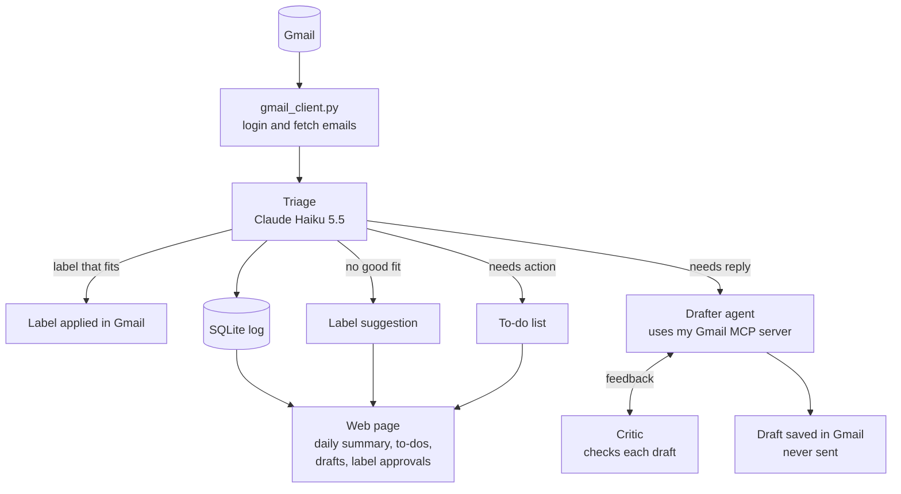

# Inbox Agent

An AI agent that organizes my Gmail. It sorts every email into labels, flags the emails that need a reply or an action from me, drafts replies, and shows everything on a web page with a daily summary. Several Claude models work together, each with its own job, and nothing is ever sent without my approval.

**Status:** Steps 1 to 4 done. The agent sorts each email into one of 15 labels designed by Claude Opus and reviewed by me, flags what needs a reply or an action, and suggests new labels for emails that fit none. It adds the labels in Gmail and archives sorted emails, so the inbox only holds what still needs me. It records every decision in a database, so it never sorts the same email twice and any run can be undone. **It sorted my whole backlog with the Message Batches API: 6,547 emails for $1.54, taking the inbox from 6,494 emails to 60.** Step 5 is built: my own Gmail MCP server, whose tools can search and read emails, list my to-dos and save reply drafts, but never send, delete or archive. It works in Claude Desktop. Step 6 is built: a Drafter agent (Claude Sonnet) that writes replies in my style, using a writing-style file learned from my sent emails and the MCP server's tools, and a Critic (Claude Opus) that checks every draft before it can be saved. **Now: Step 7, the web page:** a FastAPI app with HTML templates, HTMX and Tailwind, with Action needed, Unsorted and History pages, and a two-stage read so that actions come with exact steps, links and deadlines. The first pieces are built: the web app runs on my computer, where only I can open it, with a shared layout: a menu for its three pages and the "Sort new emails" button, styled with Tailwind and the Inter font.

## How it works



Built so far: `gmail_client.py`, Triage (including applying labels in Gmail), the Label Designer, the SQLite log, the backlog sorter, the Gmail MCP server, the Drafter and the Critic. The web page is in progress.

### The Gmail MCP server's tools

| Tool | What it does | Can change Gmail? |
|---|---|---|
| `search_emails` | Searches all mail with Gmail's search syntax, and returns sender, subject, date, preview and labels | No |
| `read_thread` | Returns a whole conversation: each message's sender, recipients, date and text | No |
| `list_todos` | Recent emails the agent flagged as needing a reply or an action that are still in the inbox | No |
| `create_reply_draft` | Saves a reply inside a conversation as a draft. It is never sent. Reply by default, Reply all only when asked | Only adds a draft |

There is deliberately no tool to send, delete, archive or relabel anything.

### How the MCP server works

**Three layers.** `gmail_client.py` holds everything that talks to Gmail, and my own scripts use all of it, including the functions that change labels. `gmail_mcp_server.py` is the menu offered to AI apps: it picks the safe abilities, describes them for a model and leaves the rest out. The model itself (Claude) only reads and writes text. When it wants a tool, it asks the app it runs in, and the app makes the call. The model never talks to the server directly.

```
You ──▶ App (Claude Desktop) ──▶ Model (Claude): "call list_todos"
              │
              ▼
        gmail_mcp_server.py ──▶ Gmail + my database
              │
              ▼
        App ──▶ Model: "here's the result" ──▶ answer to me
```

**stdin, stdout and stderr.** The app starts the server in the background and connects to its three standard channels:

```
App                                   gmail_mcp_server.py
 │ ── stdin:  requests (JSON) ─────────▶ │
 │ ◀─ stdout: answers (JSON) ─────────── │
 │ ◀─ stderr: plain text for humans ──── │  → saved to a log, never read as JSON
```

stdin and stdout carry the conversation as JSON messages: the handshake, the list of tools, then each tool call and its answer. stderr is a side channel for warnings and errors, which the app stores in a log. That's why the code never prints to stdout: a stray message there would be read as JSON and break the connection.

| Part | Model | Job |
|---|---|---|
| Triage | Claude Haiku 5.5 | Sorts each email, flags needs reply / needs action. Cheap and fast, because it runs on every email |
| Label Designer | Claude Opus 5.5 | Reads a few hundred emails and my existing labels, and suggests labels with descriptions. Runs rarely, so the best model is worth the cost |
| Drafter | Claude Sonnet 5.5 (effort medium) | An agent: decides for itself whether to look up past emails with the MCP server's read-only tools, then writes a reply |
| Critic | Claude Opus 5.5 (effort high) | Checks each draft against everything the Drafter saw, for made-up facts, promises I never made, missed questions and wrong tone, and sends it back for changes |
| Action reader (planned) | Claude Haiku 5.5 | Reads the whole email when it may need action, and finds what to do, where and by when. Answers yes, no or unsure |
| Action reviewer (planned) | Claude Sonnet 5.5 | Looks only at the emails the Action reader was unsure about |

## Design decisions

### Who decides what

The agent acts on its own when an action is low-risk and easy to undo. It needs my approval when an action changes how the whole system behaves, and it never does anything that can't be undone.

| Action | Who decides | Why |
|---|---|---|
| Apply a label | Agent alone | Affects one email, easy to undo |
| Archive a sorted email | Agent alone | Easy to undo. Emails that need a reply or an action, and Unsorted ones, stay in the inbox |
| Flag "needs reply" or "needs action" | Agent alone | It's only information |
| Create a new label | Agent suggests, I approve | Changes how every future email is sorted |
| Draft a reply | Agent alone | It's only a draft |
| Send an email | Never the agent | Can't be undone |

**Why the agent doesn't create labels by itself:** it only sees one email at a time, but a good label covers a pattern across many emails. Letting it create labels freely would lead to near-duplicates ("Job Alerts", "Job Notifications"), each new label would change where future emails go, and anyone who emails me could influence my inbox's structure. Instead, emails that fit no label go to "Unsorted" with a suggested label. The web page groups similar suggestions, and I approve, edit or reject them.

### Safety

- **No send or delete tools.** The agent can label, flag and draft, nothing more. Even if an email tricks the model, it can't send or delete anything.
- **Prompt injection defense.** Anyone can email me, so email content is untrusted. The email goes inside `<email>` tags, and the prompt says to treat everything inside them as content, never as instructions. Triage also has no tools, so the worst a malicious email can do is get itself mislabeled.
- **Least privilege, and being honest about its limits.** The app asks Google only for the permissions the current step needs. Steps 2 and 3 were read-only. Applying labels needs `gmail.modify`, the narrowest Google permission that can change labels on emails. It also covers drafts and sending, so the real safety boundary is the code: `gmail_client.py` has no function that sends or deletes anything.
- **Every change can be undone.** The agent only adds labels and archives, and it never deletes anything. Every change is logged, and `undo.py` reverses the last run: it removes the labels the agent added and moves archived emails back into the inbox. Labels that were already on an email, for example from my own Gmail filters, are recorded as such and left alone by undo.
- **Archive only what doesn't need me.** Emails that need a reply or an action, and Unsorted ones, stay in the inbox. So a wrong label can never hide something I have to deal with.
- **Start small and check.** The first real run labeled only 10 emails. A separate check read the labels back from Gmail, rather than trusting the script's own output. Undo was tested the same way before relabeling.
- **Secrets stay out of Git.** The API key (`.env`), the Google app file (`credentials.json`) and my saved login (`token.json`) are all in `.gitignore`.
- **Less data sent to the model.** Triage sends only the sender, subject and preview, not the full email.
- **The MCP server is safe by construction.** Its tools can only read and save drafts. Each tool is marked with MCP annotations (`read_only_hint`, `destructive_hint`), so apps know which ones change something and can ask before using them. The server also tells every app that email content is untrusted, and to treat it as information, never as instructions.
- **Personal data stays out of Git.** The Label Designer's suggestions quote subjects from my real emails, and its label descriptions name companies I applied to, so `labels_proposed.json` is in `.gitignore`. The final label file will be handled the same way, with a shareable example file in the repo instead.
- **Only my computer can open the web page.** Its server listens on 127.0.0.1 rather than on the network, so other devices on the same Wi-Fi can't reach it. That matters because the page will have buttons that change my Gmail.
- **Email content can't run as code on the web page.** The templates escape every value they fill in, so a `<` in an email subject is shown as text. A test with a planted `<script>` tag confirmed it.
- **No outside scripts on the web page.** Every file the browser loads comes from my own app, because a script from somewhere else, running at my app's address, could read my pages and press my buttons. So Tailwind's styles get built into a local CSS file instead of loaded from a CDN, and FastAPI's automatic documentation pages, which load scripts from a CDN, are switched off. The font is served by the app too: loading it from Google Fonts would tell Google about every page I open.
- **The web app can't hand out other files.** It only serves files from `web/static/`. Requests that try to climb out of that folder, like `/static/../../token.json`, get "404 Not Found".

### Engineering choices

- **The right model for each job.** Haiku for high-volume sorting, stronger models only where judgment matters.
- **Structured outputs instead of parsing text.** Triage describes the answer it wants as a Pydantic class. The API forces Claude to answer in exactly that shape, and the label field only allows names from the label list, so Claude can't invent a label.
- **The agent reads, the code writes.** The Drafter only gets read-only tools (search and read emails). Saving the draft is done by my code, and only after the Critic approves. The model can't skip the review, because it has no way to save anything itself.
- **Limits are enforced in code, not only asked for in the prompt.** The Drafter's prompt says its lookups only cover emails with the people who wrote in the conversation, but the code also adds that limit to every search and refuses other conversations. A prompt can be ignored or tricked; code can't.
- **Learn the style once, reuse it every time.** Instead of the Drafter looking up how I write for every draft, a writing-style file is built once from my sent emails, and I can read and edit it. It's cheaper, more predictable, and under my control.
- **The reviewer sees the same evidence as the writer.** Everything the Drafter looked up goes to the Critic as well, so the Critic can check every fact in the draft against what the Drafter actually saw.
- **Placeholders instead of guesses.** When a reply needs something only I know (availability, a decision, a price), the Drafter writes a placeholder like `[your availability]` and lists it, instead of inventing an answer.
- **Give the model what it always needs.** The Drafter gets the conversation up front instead of spending a turn fetching it. It decides for itself whether anything else is worth looking up.
- **Workflow where possible, agent where needed.** In triage, my code decides every step and Claude makes one decision per email (a workflow). The Drafter will be a real agent that decides for itself which tools to use.
- **Gmail code separate from AI code.** All Gmail code is in `gmail_client.py`. That keeps the AI code simple, and it's what will become my Gmail MCP server.
- **My own MCP server instead of a ready-made one.** Community Gmail MCP servers usually include send and delete, and would mean trusting someone else's code with my inbox. My own server only has the tools I choose, and it also works in Claude Desktop.
- **Gmail filters and the agent work together.** My filters already sort job alerts by sender address. The agent catches the ones the filters miss by recognizing what an email is, not just who sent it.
- **Facts come from code, judgment comes from the model.** Anything the code can check for itself (like whether a label already exists in Gmail) is computed in code, not asked of the model. The model is only used for decisions that need judgment. The other way around applies too: the model finds a deadline, but whether that makes an email *urgent* is a rule in my code (planned for Step 7).
- **A cheap first pass for everything, a careful second pass where it pays off (planned).** Triage reads only the preview of every email. Only emails that may need action get a full read.
- **A model cascade (planned).** A cheap model (Haiku) does the full read, and a stronger one (Sonnet) only reviews the cases the first one is unsure about. "Unsure" is defined concretely in the prompt, because a model's own sense of uncertainty isn't fully reliable.
- **Missing a to-do is worse than a false alarm.** The action check leans towards flagging, and there's a manual "Needs action" button as a safety net.
- **Label descriptions are the prompt.** The model only knows what a label means from its description, so fixing wrong labels usually means rewriting descriptions.
- **A log of every decision.** A SQLite database (`inbox_agent.db`) records what the agent decided about each email and whether it added the label. So no email is processed (or paid for) twice, any run can be undone, and the log will feed the daily summary and accuracy tests.
- **Dry run by default.** `triage.py` only changes Gmail when you add `--apply`. Running it without that is always safe.
- **To-dos only for recent emails.** Emails older than 30 days are archived even if flagged as needing a reply or an action, because they've been dealt with. The flags are still logged, as test data for the model.
- **stdout belongs to MCP.** An MCP server talks to its app over stdin/stdout, so any stray `print()` would break the connection. All messages in `gmail_client.py` go to stderr instead. The server also never opens a browser to sign in, because nobody would see it. If the Gmail login has expired, the tool says so, and I sign in by running a script.
- **One Gmail request at a time in the server.** Apps can call several tools at once, each on its own thread, but Google's client library isn't safe to use from two threads at once. A lock makes the tools take turns.
- **Bulk where it pays.** Fetching emails uses Gmail batch requests (50 at a time). The 6,500-email backlog will use Claude's Message Batches API (half price, results within hours), while the daily run stays one email at a time, since that's only a few emails.
- **Gmail labels aren't folders.** An email is stored once, whatever its labels. "Inbox" is just another label, and archiving removes it. So labeling and archiving don't change storage. The point of archiving is a clear inbox, not saving space.
- **Database migrations.** When the log gained an `archived` column, `database.py` adds it to existing database files automatically, instead of requiring the old log to be deleted.

## Progress log

### Step 1: First call to Claude
- **Built:** `hello_claude.py` sends Claude a sample email and asks for a category, whether it needs a reply, and why.
- **Learned:** what an API call contains (model, system prompt, messages, effort), why the reply comes as a list of blocks, and how tokens determine cost.
- **Result:** correct answer ("Friends, needs reply") for about $0.002.

### Step 2: Connect to Gmail
- **Built:** `gmail_client.py` holds all the Gmail code (login, fetching emails, converting them into a simple `Email` object). `show_inbox.py` prints the 20 newest inbox emails.
- **Learned:** how OAuth login works (my password never reaches the app; it gets an access token and a refresh token, saved in `token.json`), scopes, and the Gmail API's two-step pattern (list email IDs, then fetch each email's details).
- **Notes:** while the Google app is in testing mode, Google ends the login every 7 days. The code notices and opens the browser to sign in again.

### Step 3: Triage (dry run)
- **Built:** `triage.py` sorts the 20 newest emails into 7 starter labels with Claude Haiku 5.5, and flags which need a reply. It only prints the results.
- **Learned:** structured outputs with Pydantic, system prompts versus user messages, effort levels, and prompt injection.
- **Result:** 20 emails sorted for $0.0026, about 13 cents per 1,000 emails. Every label was sensible. None were marked as needing a reply, which is correct, because all 20 were automated emails.
- **Found:** two similar career-advice newsletters got different labels ("Job Alerts" and "Promotions"), because neither description said where newsletters belong. This led to the decision that label descriptions need care, and that the agent should suggest labels rather than create them.
- **Ideas from review:** a "needs action" flag for emails that need me to do something rather than reply (sign a contract, verify an account), and an "Unsorted" label with suggestions for emails that fit no label.

### Step 3b: Triage upgrade (needs action, Unsorted)
- **Built:** triage now also returns `needs_action` with a short to-do (`action`), and can choose "Unsorted" with a `suggested_label` and `suggested_description`. It prints a summary at the end (emails per label, how many need a reply or action), and `python triage.py 50` sorts more than 20 emails.
- **Learned:** optional fields in structured outputs (`str | None`), `Field` descriptions that act as instructions for each field, writing prompt rules for edge cases, and `if __name__ == "__main__"` so the web page can reuse `triage()` later.
- **Result:** on the 50 newest emails, all 8 real actions were found: a contract to sign (and its reminder), a Workday account to verify, and five LinkedIn messages from a recruiter. Two emails went to Unsorted with sensible suggestions: "University" (graduation ceremony) and "Social Notifications" (LinkedIn post reactions). Cost: $0.0111 for 50 emails, about 22 cents per 1,000. That's up from 13 cents because the prompt and the answer are longer.
- **Found:**
  - A first test gave inconsistent results for LinkedIn "X just messaged you" emails: one marked as needing a reply, two marked as nothing. These are automated notifications, and the reply happens on LinkedIn, not by email. A new prompt rule fixed it: a message from a real person on another site counts as an **action** (reply on that site), not an email reply. After the fix, all five were consistent.
  - LinkedIn sent five separate notifications for the same conversation, which gave five identical to-dos. The web page should group to-dos from the same conversation.
  - Career newsletters are still split between "Job Alerts" and "Promotions". That gets fixed with label descriptions in Step 4.

### Step 4a: Label Designer
- **Built:** `label_designer.py` reads the 200 newest inbox emails plus 5 examples from each label I made in Gmail, and asks Claude Opus 5.5 (effort high) to design a label set. It saves the suggestion to `labels_proposed.json` for me to review, and prints it with example emails for each label and notes on decisions I should check. `gmail_client.py` gained `list_labels()`, and `list_recent_emails()` can now read any label, not just the inbox.
- **Learned:** streaming (receiving a long answer piece by piece so the connection doesn't time out), giving each email a number so the model can point to examples instead of copying them, and asking the model to list its own uncertain decisions.
- **Result:** 12 suggested labels for $0.32, read from 210 emails. They include my LinkedIn and Indeed alert labels, plus Applications, LinkedIn Updates, University, Events, Orders & Payments, Security & Logins, Promotions and a "Job Alerts" label for other job boards. The descriptions are specific: they name typical senders and say where borderline emails go, such as career newsletters and job-application login codes.
- **Found:**
  - **The model got a fact wrong.** It marked "Job Alerts" as one of my existing labels, but no such label exists. Fix: the code now checks this itself against the real Gmail labels.
  - **Labels made by a mail app.** Gmail has two labels I didn't make myself, `[Imap]/Drafts` and `Junk Email`, probably created when my Gmail was connected to a mail app like Outlook. Both are empty. Because the prompt said to keep every existing label, the model invented new meanings for them. They should be left out.
  - **No "Personal" label.** The sample had almost no emails from real people, so the model didn't create one. But emails from real people are rare and important, so a Personal label is probably still worth having.
  - **The descriptions contain personal details:** companies I applied to and a recruiter's name. That's why the label files stay out of Git.

### Step 4b: Final labels, and triage uses them
- **Decided:** left out `[Imap]/Drafts` and `Junk Email`, so Sovendus voucher mail goes to Promotions. Kept a separate "Job Alerts" label for job boards other than LinkedIn and Indeed. Kept LinkedIn messages from real people in "LinkedIn Updates", because they already appear on the to-do list. Added a "Personal" label for emails from people I know.
- **Built:** `labels.json` holds my 11 final labels with their descriptions. It's kept out of Git, and `labels.example.json` is a shareable version with generic descriptions. `triage.py` now reads its labels from `labels.json`, or from the example file if there's none yet, so nothing about my labels is hard-coded anymore.
- **Result:** on the 50 newest emails:
  - **No email went to Unsorted.** In the last run, two did, and both now have a label (University, and LinkedIn Updates).
  - **Career newsletters are now consistent.** Each one follows the rule in its label's description: LinkedIn's goes to LinkedIn Updates, Indeed's tips go to Indeed Alerts, and the university career portal goes to University.
  - **All 8 actions were found again:** 3 contract-signing emails and 5 LinkedIn messages.
  - **Cost:** $0.0173, or about 35 cents per 1,000 emails. That's up from 22 cents, because the longer label descriptions are sent with every email.
- **Learned:** keeping settings in a data file instead of in code, and the `.env` / `.env.example` pattern applied to personal data (a private file plus a shareable example).
- **Idea:** triage sends the same system prompt with every email, so prompt caching (a discount for repeating the same text) could cut the cost. Worth checking whether the prompt is long enough to qualify.

### Step 4c: Applying labels in Gmail
- **Built:**
  - `gmail_client.py`: `get_or_create_labels()` creates any missing labels in Gmail, `add_label()` and `remove_label()` change one email's labels, and each `Email` now knows which labels it already has.
  - `database.py`: a SQLite log with one row per email: the decision, the reason, the cost, the run it belonged to, and whether the agent actually added the label.
  - `triage.py --apply`: applies the labels and logs each decision, and skips emails that are already in the log. `undo.py` reverses the last run.
- **Learned:** SQLite and SQL basics (`CREATE TABLE`, `INSERT`, `SELECT`, `DELETE`), why queries use `?` placeholders (to stop SQL injection), `argparse` for command-line options, and checking an action's real effect instead of trusting the script's own output.
- **Result:**
  - The first run created 10 new labels in Gmail and labeled the 10 newest emails, for $0.0035.
  - A check read each email back from Gmail: 10 of 10 had their label, and all were still in the inbox.
  - `undo.py` removed all 10 labels, which was again checked in Gmail, and relabeling put them back.
  - A second run skipped all 10 emails as already sorted, without calling Claude.
- **Found:**
  - One Indeed job email didn't have my "Indeed Alerts" label, because my Gmail filter missed it. The agent added it. That's exactly the gap the agent is meant to fill.
  - A bug: a run with nothing new still printed "to undo this run, run undo.py". That run records nothing, so undo would have reversed the run before it. Fixed: the hint only appears when a run changed something.

### Step 4d: Archiving
- **Decided:** archive emails once they're labeled, so the inbox works as a to-do list. Emails that need a reply or an action, and Unsorted emails, stay in the inbox.
- **Built:** `change_labels()` in `gmail_client.py` adds and removes labels in one request. It replaced `add_label()` and `remove_label()`, because archiving is just removing the INBOX label. `triage.py --apply` now archives sorted emails (`ARCHIVE_SORTED_EMAILS` turns this off), the log records which emails were archived, and `undo.py` moves them back into the inbox.
- **Learned:** Gmail labels aren't folders, so archiving doesn't change storage. The benefit is a clearer inbox. Also learned database migrations (`ALTER TABLE`), for adding a column to an existing database.
- **Result:** undid the first 10 and re-sorted the 10 newest with archiving. 8 were labeled and archived. The 2 that still need me stayed in the inbox: a contract to sign and a LinkedIn message. A check in Gmail confirmed every label and inbox status.
- **Also decided:** the two empty labels my old mail app created (`[Imap]/Drafts` and `Junk Email`) get deleted by hand in Gmail's settings, not by the agent. That way the agent's code still has no ability to delete anything.

### Step 4e: First bigger batch
- **Result:** `python triage.py 50 --apply` sorted 48 new emails (2 were already sorted and got skipped) in 94 seconds, for $0.0165. 42 were labeled and archived. 6 stayed in the inbox because they need me: 4 LinkedIn message notifications and 2 contract-signing emails. A check in Gmail confirmed all 48 labels and inbox statuses. The two old labels are deleted.
- **Found:**
  - **The inbox holds 6,529 emails.** At the current speed (about 2 seconds per email, one at a time) and cost ($0.00034 per email), sorting all of them would take about 3.6 hours and cost about $2.25. Before doing that, a few decisions are needed (see Open questions).
  - **One email at a time is slow for a backlog.** For thousands of emails, Claude's Message Batches API fits better: it processes requests in the background at half the price.
  - **Gmail returns at most 500 emails per request,** so sorting the full inbox needs paging through the results.

### Step 4f: Getting ready for the backlog
- **Decided:**
  - Check the labels against **200 random emails from the last 5 years**, not just recent ones, before sorting the backlog.
  - For **past emails, ignore "needs reply" and "needs action"**: they've all been dealt with. Triage still records the flags (useful for testing the model later), but emails older than 30 days get archived whatever their flags say.
  - Process the backlog with the **Message Batches API**: half price, and speed doesn't matter.
- **Built:**
  - `gmail_client.py`: `list_message_ids()` pages through any number of emails, 500 per request, and accepts Gmail search queries like `newer_than:5y`. `get_emails()` fetches emails in bundles of 50 (Gmail "batch requests"), pausing between bundles to respect Gmail's rate limit and retrying any that fail. `list_recent_emails()` uses both.
  - `triage.py`: `KEEP_IN_INBOX_DAYS = 30`. Older emails are archived even when flagged.
  - `label_designer.py` now **improves the current labels** instead of starting over. It reads `labels.json` (descriptions) and examples from each Gmail label, plus a random sample with each email's date. It keeps label names stable, because renaming means relabeling. The code works out which labels are new, edited, unchanged or removed by comparing with the current file, rather than asking the model.
- **Result:**
  - Bulk fetching got 120 emails in 5 seconds, instead of about a minute one by one. Listing all 6,494 inbox IDs took 3 seconds. 5,776 of them are from the last 5 years, and 718 are older.
  - The Label Designer read 236 emails for $0.41. It suggested 4 new labels for types the recent sample never showed: **Travel**, **Housing**, **Marktplaats** and **Admin & Health**. It improved the descriptions of 10 others, for example adding the universities I attended before and older job boards, and left Indeed Alerts unchanged. 15 labels in total.
- **Learned:** random sampling to get a representative picture of thousands of emails, paging through API results, batch requests and rate limits, and retrying with increasing waits ("exponential backoff").

### Step 4g: Sorting the backlog with the Message Batches API
- **Decided:** accepted all 15 labels. JobTeaser job matches stay in University. The backlog includes every inbox email, also the 718 older than 5 years.
- **Built:**
  - `backlog.py` with four steps:
    - `sample` is a live dry run on random unsorted emails.
    - `submit` sends every unsorted inbox email to Claude as one batch, with each email's ID as the request's `custom_id`.
    - `wait` checks the batch once a minute.
    - `apply` reads the results, gets each email's current labels from Gmail, groups emails that need the same change, and applies each group with Gmail's `batchModify` (up to 1,000 emails per request). Then it logs every decision as one run.
  - The batch requests use the same prompt and answer shape as live triage. The SDK's `transform_schema()` turns `TriageResult` into the JSON schema that `messages.parse()` normally builds for us.
  - `change_labels_bulk()` in `gmail_client.py`, and `undo.py` now uses it too, so undoing thousands of emails takes a few requests instead of thousands.
- **Dry run:** 40 random unsorted emails from 2019 to 2026 with the new labels, for $0.0187: **0 went to Unsorted**. The new labels caught their cases, such as a 2022 rental alert (Housing) and a physio appointment (Admin & Health).
- **Found:**
  - **Gmail's per-minute limit.** The first `submit` could only fetch 3,653 of the 6,486 emails. Gmail answered the rest with "Quota exceeded for quota metric 'Total Query Cost' and limit 'Units per minute per user'", and my retries only waited up to 8 seconds. A test script showed the errors started after just 44 requests. Fix: `get_emails()` now waits a full minute when Gmail refuses because of the limit, then carries on where it stopped. It also tells temporary errors (limits, brief outages) apart from permanent ones, like a deleted email, which it skips instead of retrying forever. Gmail allows this account roughly 400 to 500 emails per minute, so fetching 1,500 now takes 3.5 minutes with nothing missed.
  - The skipped emails weren't lost. They weren't in the log, so they went into a second batch.
  - The first version of `apply` said "to undo the whole backlog, run undo.py". But each `apply` is its own run, so undo only reverses the last batch. The message now says so.
- **Result, batch 1:** 3,653 emails, finished by Claude in about 8 minutes with 0 errors. Cost: **$0.86** at half price (about $0.24 per 1,000 emails). In Gmail, 3,604 were labeled and archived, and 49 recent emails that need me stayed in the inbox. Only 28 went to Unsorted (0.8%). The biggest labels were Promotions (719), University (665), LinkedIn Updates (490), Orders & Payments (396) and Housing (314).
- **Result, batch 2:** all 2,836 remaining emails were fetched with the fixed code, with none skipped. Claude finished them with 0 errors. 2,835 were archived and 1 stayed in the inbox, for **$0.66**. 17 went to Unsorted.
- **Checked:** read 150 random backlog emails back from Gmail. **150 of 150** had their label, and their inbox status matched the log.
- **In total:**
  - **The inbox went from 6,494 emails to 60.** The 58 kept there are recent and need me (34 of them are Marktplaats messages from buyers or sellers), plus 2 new emails.
  - **6,547 emails sorted for $1.54 in total.** That includes the earlier live runs and Label Designer tests.
  - **Only 45 emails (0.7%) went to Unsorted.**
  - Across all ages, the model flagged 751 emails as needing an action and 179 as needing a reply. They were archived anyway if older than 30 days. They're test data for checking the model's judgment later.

### Step 4h: Re-sorting the first emails
- **Built:** `undo.py --list` shows every run, and `undo.py --run RUN_ID` undoes any one of them, not just the last.
- **Result:** undid the two runs from before the 4 new labels existed (58 emails), then ran `python triage.py 150 --apply`. It re-sorted those 58, plus 30 new emails, for $0.04. The Ryanair itinerary moved from Orders & Payments to Travel.
- **Decided:** not to add labels for the 45 Unsorted emails. Most of them fit an existing label in an ambiguous way, or need personal context to sort. The web page will make it easy to change an email's label by hand instead.
- **Found:** triage flagged "attend the appointment on 23 October" as a to-do on 25 October, because it doesn't know today's date. Fix (to do): give triage today's date and each email's date.

### Step 5: My own Gmail MCP server
- **Built:**
  - `gmail_mcp_server.py` uses the official MCP Python SDK (version 2) to offer 4 tools: `search_emails`, `read_thread`, `list_todos` and `create_reply_draft`. Each tool's docstring becomes the description the model reads, and its type hints become the input schema. Annotations mark the read-only tools, and server-wide instructions warn the model that email content is untrusted.
  - `gmail_client.py` gained:
    - `get_thread()`, which reads a whole conversation. It walks each email's tree of parts, prefers the plain text, and falls back to HTML with the tags stripped.
    - `create_reply_draft()` and `build_reply()`, which reply to the newest message from someone else, with the `In-Reply-To` and `References` headers that keep the reply inside the conversation.
    - `get_my_address()`, plus searching all mail rather than only one label.
  - `check_mcp_server.py` starts the server the way an app would, lists its tools and tries the read-only ones. The Drafter in Step 6 will connect the same way.
- **Learned:** what an MCP server actually is (a program that describes its tools and answers calls over a standard protocol), the stdio transport, tool annotations, how email bodies are stored (MIME parts in base64url encoding), and how email apps link replies to conversations.
- **Result:**
  - The check started the server, which offered all 4 tools with the right read-only markings.
  - `search_emails` found inbox emails with their label names, `list_todos` returned 17 to-dos (such as signing the contract and a Ryanair customer verification), and `read_thread` returned a full message.
  - A separate test read a real 4-message conversation and built a reply (without saving it) that goes to the other person, with the right headers.
- **Found:**
  - **The SDK had changed.** In version 2 of the MCP Python SDK, the `FastMCP` class from most tutorials is called `MCPServer`, and the client API changed. Reading the migration guide and the installed code, rather than guessing, got it right the first time.
  - **Structured answers need precise types.** A tool declared as returning plain `dict` sent its answer as text instead of structured data. Declaring `dict[str, Any]` fixed it.
  - **The to-do list shows the past-dates bug from Step 4h:** a medical appointment from two days ago is still listed.

### Step 5b: Triage knows today's date
- **Built:** each email sent to triage now starts with today's date, and the email's own date and time. A new prompt rule says that an appointment, event or deadline that has already passed needs no action. The date goes in the message, not the system prompt, so the system prompt stays identical for every email (which prompt caching needs).
- **Result:** in a dry run, the two appointment emails from 23 October were no longer flagged ("a healthcare appointment that already took place on 23 October, so no action is needed"), while real actions like the contract and a Ryanair verification still were. I undid the last run and re-sorted it (99 emails, $0.05), which archived the past appointments and left 12 real to-dos in the inbox.
- **Learned:** a model only knows what's in its context. It has no clock, so anything time-dependent needs the date passed in.

### Step 6: The Drafter agent and the Critic
- **Built:** `drafter.py`, my first real agent.
  - **The Drafter (Claude Sonnet 5.5)** gets the conversation and, if I give one, my note about what to say. It connects to my Gmail MCP server exactly like Claude Desktop does, but only gets its read-only tools (`search_emails`, `read_thread`), plus one tool defined in my code: `submit_draft`.
  - **The agent loop** is about 30 lines I wrote myself instead of using a library: send the conversation to Claude, run any tools it asks for, send back the results, and repeat until it calls `submit_draft`. Every turn is appended unchanged, thinking included, because editing the history would throw away the model's earlier reasoning. A step limit stops a confused agent from running up costs.
  - **`submit_draft`** runs **the Critic (Claude Opus 5.5)**, a single structured-output call that returns `approved`, a list of problems by kind (`invented_fact`, `unapproved_promise`, `missed_question`, `tone_or_language`, `other`) and a summary. The verdict goes back to the Drafter as the tool's result. If there are problems, the Drafter revises and submits again, for at most 3 reviews.
  - **Only with `--save`**, and only once the Critic approves, my code saves the reply as a Gmail draft through the MCP server.
  - Prompt caching on the Drafter's turns, so the part of the conversation it resends every turn costs a tenth of the price.
- **Learned:**
  - the agent loop itself (stop reasons, `tool_use` and `tool_result` blocks, sending several tool results back in one message),
  - connecting my own code to an MCP server as a client,
  - mixing MCP tools with a tool defined in my code,
  - why the history must stay unchanged,
  - the writer-and-reviewer pattern (one model writes, another checks).
- **Result:**
  - A dry run on a real 8-message conversation wrote a short reply in my usual style, with my usual greeting and sign-off. It left a placeholder for what only I can decide, and noticed that the conversation is four months old. The Drafter decided no extra lookups were needed, and the Critic approved it on the first try. Cost: **$0.085** ($0.033 Sonnet, $0.052 Opus).
  - **Testing the Critic:** I gave it a deliberately bad draft for the same conversation, with an invented date and a promise I never made. It rejected the draft and caught both, plus three more problems: the invented date (14 November 2026) is a Saturday, not a Friday; "present it again" was wrong because the other person presented the poster, not me; and a reply four months late should acknowledge the delay. Cost: $0.06.
- **Not yet tested:** a draft that needs a revision round, and a draft that needs the Drafter to look up other emails. Both will come up with real use.

### Step 6b: Reworking the Drafter with my decisions
- **How we work from now on:** each design decision is laid out with its options, I decide, and the code is built in small pieces I can check. In the first version of Step 6, every choice was made for me, so this step revisits them.
- **Decided:**
  - **The Drafter stays a separate agent,** a client of the MCP server, called from the web page. The MCP server stays a toolbox with no AI inside it. The web page is my hub; the MCP server is the AI apps' hub for Gmail.
  - **A writing-style file instead of looking up my style every time.** It's built once by Claude Opus from the emails I sent in the last 5 years, with newer ones counting more. One style for everything, because nearly all my emails are formal and in English. If I need something more casual, I'll say so in the hints box. The Drafter gets it with every draft, and the Critic uses it to check tone.
  - **An about-me file that I write myself** from a short template (name, how I sign, my situation, what the Drafter may and may not say). Facts guessed from old emails can be out of date, and anything in this file can end up in a reply. The Critic gets this file too, so it doesn't flag those facts as invented.
  - **Lookups only within conversations with the people who wrote in this conversation.** Emails from anyone else can't influence a reply. If a reply needs a fact from elsewhere, I add it in the hints. At first this was only the person I'm answering, but in a group conversation that misses earlier context with the others who wrote. People who were only in To or CC don't count, so a group email to a mailing list doesn't open up half my mailbox.
  - **In a group conversation, the newest message from someone else gets answered.** If a different message needs the answer, I say so in the hints and choose Reply all.
  - **Everything is manual, through the web page, nothing automatic:**
    - a "Sort new emails" button,
    - a "Draft reply" button with a hints box on each email that needs a reply,
    - the draft shown with the Critic's verdict, where I decide whether to save it, even if the Critic isn't satisfied.
  - **Reply, not Reply all,** unless I say otherwise in the hints box.
  - **Showing it outside the house:** install the project on my laptop from GitHub when needed. A demo mode with made-up emails, safe to show in interviews, comes at the end.
- **Built so far:**
  - `get_message()` in `gmail_client.py` reads one full email.
  - `_execute()` waits out Gmail's per-minute limit for single requests, the same fix as in Step 4g, which my new function had missed at first.
  - `style_builder.py collect` gathers my sent emails from the last 5 years, leaving out emails to myself. It keeps only the text I wrote, cutting quoted older messages, forwards and "Sent from my iPhone" lines, and saves them to `style_source_emails.json` (not in Git).
- **Result:** 134 emails with real text of my own; 56 were skipped for having almost none. Most are recent (55 from 2026, 23 from 2025). They're short: the median is 162 characters.
- **Found:** a first check found quoted text left in 10 emails. Gmail wraps long "On [date], [name] wrote:" lines, so "wrote:" can sit alone on the next line, and there are three different forward formats (Apple's "Begin forwarded message:", and Gmail's "Forwarded Conversation" with and without dashes). After fixing the patterns: 0 left.
- **Decided (next piece):**
  - Newer emails count more: they're grouped by year, newest first, with the instruction to follow newer habits where they differ.
  - The style file has fixed sections: a rich overview of my voice (one or two full paragraphs), greetings and sign-offs by kind of recipient, tone, length and structure, phrases I often use, things I never do, and a few example sentences.
  - It contains no personal details.
  - My profile files live in `profile/` (not in Git), with generic versions in `profile.example/`.
  - For PC and laptop: Gmail is the source of truth. An email that already has one of the agent's labels counts as sorted, and to-dos get their own Gmail label. Moved to later, together with the demo, if I build it.
- **Built:**
  - `style_builder.py write`: Claude Opus 5.5 (effort high, streaming) reads the collected emails and writes `profile/writing_style.md`. If that file already exists, it writes `writing_style.proposed.md` instead, so my own edits are never overwritten.
  - `profile/about_me.md`, a template I fill in myself, with an example version in `profile.example/`.
- **Decided (connecting it to the Drafter):** the Drafter always gets my last 3 emails to the person (from other conversations). Reply all is a yes/no the Drafter sets only when my hints ask for it; anything else, like adding a CC, goes in the hints or I do it in Gmail. Lookups are limited to emails from, to or CC'd to anyone who wrote in the conversation.
- **Built (connecting it to the Drafter):**
  - **Reply all:** `build_reply()` and the MCP tool `create_reply_draft` take a `reply_all` option that puts everyone else on the message in CC. `submit_draft` gained a required `reply_all` field, and the Critic flags it as a `recipients` problem if my hints didn't ask for it.
  - **`read_thread`** now marks each message `from_me` and includes its CC line, so the code can tell who the person is. The quote cleaner moved from `style_builder.py` into `gmail_client.py` (`strip_quoted()`), so the Drafter can reuse it.
  - **In `drafter.py`:**
    - `find_person()` works out who I'm answering: the sender of the newest message that isn't mine.
    - `my_recent_emails_to()` fetches my last 3 emails to them from other conversations, with only my own words.
    - `load_profile()` adds both profile files to the Drafter's and the Critic's system prompts, where they're cached because they rarely change.
    - `find_writers()` lists everyone who wrote a message in the conversation.
    - `run_lookup()` enforces the limit in code. Every search gets `{from:X to:X cc:X …}` added for each writer (in Gmail search, `{}` means OR), and `read_thread` refuses conversations none of them are in, telling the Drafter why.
- **Result:** a 1,016-word style file from 134 emails, for $0.15. It's concrete. For example: "Dear [Title] [Last name]," for university staff, "Best wishes," as my most common sign-off, mostly 2 to 5 sentences, "Firstly… Secondly…" in problem reports, lists only in formal claims, and a list of phrases I really use. No personal details ended up in it.
- **Tests:**
  - **Reply all, on a made-up group conversation:** Reply went only to the sender, and Reply all added the other two people in CC, leaving out me and a duplicate address.
  - **The lookup limit:** a search for everything returned 20 emails, all involving the person (10 from them, 8 from me to them, and 2 from someone else to them). A conversation without them was refused, and their own conversation was allowed.
  - **Group conversations**, on a real 14-message conversation with two other writers: a broad search returned 15 emails, all involving one of them. A conversation with only the *other* writer was allowed, which the first version would have refused. An unrelated conversation was still refused.
  - **The full Drafter**, on the same real conversation as before: it found my 3 earlier emails to the person and both profile files. It wrote a reply in my style ("Dear Ms. Hendrikse," … "Best wishes,"), only to her, with a placeholder for my opinion. Approved on the first try, for $0.10.

### Step 7: The web page (in progress)

**Technology**
- **FastAPI** (a Python web framework, run by the uvicorn server), **HTML templates** (Jinja2), **HTMX** and **Tailwind CSS**.
  - FastAPI: each address, like `/sort`, is a Python function.
  - HTML templates: pages that Python fills in.
  - HTMX: buttons that update part of the page without reloading it, with no JavaScript to write.
  - Tailwind: styling with small utility classes, turned into one CSS file by Tailwind's own program (see the decisions for piece 1 below).
- **Why not Streamlit:** Streamlit would be faster to build and easier to host, but I want to learn how web apps actually work and make the page look like my own. FastAPI is also a very common way to put AI agents behind an API in AI engineering jobs, and HTML and CSS are the foundation under every web framework, Streamlit included. Streamlit is quick to learn later if a job asks for it.
- **Why Tailwind:** it's the most common styling approach at modern startups, it gives full control over the design, and the skill carries over to any frontend work. The other options were Pico.css (clean with almost no effort, but less unique), Bootstrap and my own CSS.
- **It runs on my own computer** (`localhost`). Only my browser can open it, because it uses my Gmail login and API key. A demo version with made-up emails could go online later. That's the same amount of work with FastAPI as with Streamlit, except that hosting takes an hour more to set up.

**Pages**
- A menu bar with three pages, and a **"Sort new emails"** button that's always visible at the top.
  1. **Action needed:** two columns, like an email app. On the left, the list of everything that needs me (replies and other actions), with filters and counts, urgent items first, and duplicates from the same conversation grouped. On the right, the selected email with its details and buttons. When nothing needs me, an "all done" summary instead of an empty page.
  2. **Unsorted:** emails that fit no label, with the label each one suggests. I approve, edit or reject the suggestion, or pick a label myself.
  3. **History:** past runs, what was sorted where, undo, and a **"Needs action"** button to move anything the agent missed onto my Action list.
- **Why this layout:** a single page would get cluttered, and separate pages for everything would mean clicking back and forth. The two-column view fits how I'll work through emails one at a time and looks like a real product.

**Reading actions properly: a two-stage read**
- **Stage 1 (as now):** triage reads only the sender, subject, date and Gmail's preview (the first ~200 characters). That's enough to sort, but it can miss what exactly an action is, where to do it, or by when.
- **Stage 2 (new): a full read of the whole email.** It happens for every email outside the **routine labels**, plus any routine-label email that triage flags anyway.
  - **Routine labels** (never need action in practice): Promotions, Job Alerts, LinkedIn Alerts and Indeed Alerts. In the last 30 days, 284 emails arrived (about 9 a day). The 103 in those labels needed no action, and every flagged action came from the others, so this means about 6 full reads a day.
  - **Security & Logins stays non-routine,** because a "was this you?" alert can need action.
- **What stage 2 finds:**
  - the type of action: reply by email, reply on another site, sign or fill in a form, pay, verify an account, attend something, or other,
  - what exactly to do, as short steps,
  - where to do it (the link),
  - the deadline,
  - whether it's time-sensitive without a date ("as soon as possible", "today").
- **A model cascade:**
  - **Claude Haiku** reads each email and answers **yes / no / unsure**. It says "unsure" whenever an email asks for something but it can't tell whether that's required, optional or already done, and whenever it's torn between yes and no.
  - **Claude Sonnet** reviews only the unsure ones.
  - Cost estimate for this stage: about $0.50 a month, against about $2 if Sonnet read everything. The whole app should cost about $1.50 to $2 a month in normal use.
- **Why lean towards flagging:** missing an email that needs action is much worse than a false alarm I can dismiss in a second. In other words, recall matters more than precision here. The full read filters out the false alarms, and the History page's "Needs action" button catches anything both models miss.
- **Urgency is decided by code, not the model:** the model only finds the deadline. Overdue or due within 2 days counts as **urgent**, and everything else is normal. "Time-sensitive" emails without a date are marked separately.

**Build order** (one small piece at a time, with my decisions along the way)
1. A bare page that shows my current to-dos (learning how FastAPI, templates and Tailwind fit together, with nothing that changes Gmail yet), in five smaller pieces (see below)
2. The full-read step and urgency
3. The "Sort new emails" button
4. The Unsorted page
5. The History page
6. The draft flow: hints box, the Critic's verdict, and saving, also when the Critic isn't satisfied
- **Later, together with the demo (if I build it):** using the project on both my PC and my laptop, with Gmail as the source of truth and a "To do" Gmail label.

**Decisions for piece 1**
- **The web app has its own folder, `web/`.** `app.py` creates the app, `templates/` holds the HTML templates, and `static/` will hold files sent to the browser as they are, like the CSS. The agent's scripts stay where they are for now. A one-line `web/__init__.py` marks the folder as a Python package, so the server can start it as `web.app` from the project folder.
- **Only the packages it needs.** `fastapi` and `jinja2` added 4 packages in total. The server, uvicorn, was already installed because the MCP SDK uses it, and it's now pinned in `requirements.txt` as well. FastAPI's `fastapi[standard]` bundle would have added 36 packages, mostly for things this app doesn't use, like deploying to FastAPI's cloud service, error reporting and monitoring. A dry run of `pip install` showed beforehand that FastAPI leaves the Starlette version the MCP SDK relies on unchanged.
- **Started with uvicorn directly:** `python -m uvicorn web.app:app --reload`. The command shows the two layers: uvicorn is the server, and `app` in `web/app.py` is the FastAPI app.
- **Tailwind's standalone program instead of its CDN script.** The one-line CDN script is meant for development, builds the styles in the browser on every page load, and would mean trusting an outside server with a script running on a page full of my emails. The standalone program (no Node.js needed) reads my templates and writes one CSS file that my own app serves, so the browser loads nothing from outside. The program comes from Tailwind's GitHub releases and gets checked against its published SHA-256 checksum. It stays out of Git: it's 112 MB, and GitHub refuses files over 100 MB.
- **The generated CSS stays out of Git.** Files a tool can rebuild are normally built where they're needed rather than stored. An online demo would build the CSS while deploying, so its styles always match the templates.
- **Two terminals while building:** one runs the server, the other runs Tailwind, which rebuilds the CSS whenever a template changes.
- **Reorganizing the rest of the project into folders waits until after Step 7,** as its own step, once every file exists. It needs care, because two mistakes would fail silently: `database.py` would create a new, empty database if it couldn't find `inbox_agent.db`, and `triage.py` would fall back to the example labels if it couldn't find `labels.json`.
- **Piece 1 in five smaller pieces:** 1a the first page, 1b Tailwind, 1c the layout, 1d my to-dos from the database, 1e only the to-dos still in my inbox.

**Piece 1a: the first page**
- **Built:** `web/app.py`, a FastAPI app with one page at `/`, filled in from the template `web/templates/hello.html`. The page shows the time it was made.
- **Learned:**
  - How a page gets served: the browser sends a request, uvicorn (the server) receives it, FastAPI finds the function for that method and address (a "route"), and Jinja2 fills in an HTML template with the values the function passes it. It's the same pattern as my MCP server, which waits for requests on stdin and answers on stdout. A web server waits on a network port and answers with HTML.
  - GET means "show me something" and POST means "do something". Anything that changes Gmail will be a POST, because browsers resend GET requests on their own.
  - Escaping is the web version of SQL's `?` placeholders: values from outside are always treated as data, never as code.
  - Jinja comments (`{# … #}`) are removed before the page is sent, unlike HTML comments, which anyone can read with View Source.
  - A web page only exists while its server is running. When I opened the address in Chrome with the server stopped, Chrome said "This site can't be reached": nothing was listening at 127.0.0.1:8000. And 127.0.0.1 always means "this computer", so the page opens in any browser on my PC, but not from my phone.
- **Result:**
  - The page loads at http://127.0.0.1:8000. Refreshing it 11 seconds later changed the time from 13:27:49 to 13:28:00, so the page is built fresh for every request.
  - `netstat` shows the server listening on `127.0.0.1:8000` only.
  - A planted `<script>` tag came out of the template as `&lt;script&gt;`, shown as text.
  - `pip check` found no conflicts, and Starlette stayed at 1.10.0 for the MCP server.
- **Found and decided:** FastAPI adds pages of its own: `/docs` and `/redoc` (interactive documentation of the app's addresses) and `/openapi.json`, which those two read. The documentation pages load their scripts from a public CDN with only the major version fixed, so the file can change at any time, and a script running at my app's address could read my pages and press my buttons. These pages are useful for an API that other programs call, but this app serves pages to me, so I switched them off. All three now answer "404 Not Found".

**Piece 1b: styling with Tailwind**
- **Decided:**
  - The built CSS is readable on my PC, so I can open it and see what each class turns into. A public site, like the online demo, would build it minified (`--minify`).
  - An empty `web/static/.gitkeep` keeps the `web/static/` folder in Git. Git doesn't store empty folders, and the built CSS stays out of Git, so without it the app would refuse to start on a fresh clone ("Directory does not exist").
  - The template links to the CSS with FastAPI's `url_for('static', path='app.css').path`. The link is built from the folder's name in the app, and `.path` keeps it short (`/static/app.css`). That avoids a known problem behind a hosting service's HTTPS, where the full link can come out as `http://…` and get blocked.
  - Minimal styling for now. The real look comes with the layout, in piece 1c.
- **Built:**
  - Tailwind's program, downloaded to `tools/` (not in Git) from Tailwind's GitHub releases. Its SHA-256 fingerprint matched the one published with the release.
  - `web/tailwind.css`, Tailwind's input file. `source(".")` limits Tailwind to the `web/` folder.
  - `web/app.py` serves the `web/static/` folder at `/static`. The template links to the built `app.css` and uses a few Tailwind classes.
- **Learned:**
  - Utility classes: each class does one small thing (`p-8` adds space inside an element, `rounded-lg` rounds the corners), and an element gets its look from a list of them.
  - Tailwind reads files as plain text and writes CSS only for the class names it finds. It even picked up the word "static" from `web/app.py` and made a harmless `.static` rule.
  - One page is several requests: the browser gets the HTML, finds the `<link>` to the CSS, and fetches that separately.
  - A fingerprint (SHA-256 checksum) proves a download is exactly the published file. It can't prove the published file itself is safe, so it only helps together with downloading from the official source.
- **Result:**
  - The build takes 28 ms (about 1 second including starting the 112 MB program) and makes an 8 KB CSS file with no local file paths in it.
  - Every class in the template got a rule. A comparison build that read the whole project folder picked up 6 extra words from the README and Python files (`table`, `block`, `fixed`…). The real build didn't, so Tailwind only reads `web/`.
  - The browser shows a white card, 576 px wide and centered, with rounded corners and a shadow, on a light gray page. While trying out the watcher, I changed the page to light blue (`bg-blue-100`) and kept it.
  - Requests for files outside `web/static/`, like `/static/../../token.json`, get "404 Not Found".
  - The watcher (`--watch`) uses about 94 MB of memory and almost no processor time: 0.14 seconds in total, including its first build and two rebuilds. A rebuild after saving a template takes under half a millisecond.
- **Found:** the app doesn't tell browsers how long to keep the CSS (there's no `Cache-Control` header), so a browser may reuse its saved copy for a short while after a rebuild. Ctrl+F5 reloads the page without it. The usual fix is a version number in the CSS link, for later.

**Piece 1c: the layout**
- **Decided:**
  - Parts that aren't built yet are shown, clearly marked. Unsorted and History say which piece they arrive in, and the "Sort new emails" button is greyed out, with "Coming in piece 3" on hover. That way the layout is complete and testable now, and piece 3 needs a disabled button anyway, while sorting runs.
  - Blue as the accent color, for the current menu item and the Sort button, on my light blue page with a white top bar and cards.
  - The Inter font, chosen now from five options rather than left for later. The app serves it itself instead of loading it from Google Fonts.
  - Made for my PC, but not broken on a phone: on a narrow screen the top bar wraps onto three lines.
  - Action needed is the home page (`/`), next to `/unsorted` and `/history`. The top bar stays in view when scrolling, and each page has its own tab title.
- **Built:**
  - `web/templates/base.html`, the shared layout: the page's `<head>`, the top bar with the menu and the Sort button, and a slot for each page's content. `action.html`, `unsorted.html` and `history.html` fill that slot, and replace `hello.html`.
  - One route per page in `web/app.py`. Each tells the layout which menu item to highlight.
  - Inter 4.1 in `web/static/fonts/`, with its license file (the SIL Open Font License, which allows shipping it with the app), set as the font in `web/tailwind.css`. Inter publishes no checksums, so I compared two official copies instead: the font in the release on GitHub and the one on Inter's website have the same SHA-256 fingerprint.
- **Learned:**
  - Template inheritance: one layout with empty "blocks" that each page fills in, so the menu is written once.
  - Links are for going (a GET request for another page), buttons are for doing (they'll send a POST).
  - Tailwind variants: a prefix applies a class only in some situations, like `hover:` or `disabled:`. In the CSS, `.disabled\:opacity-50:disabled` means "this class, while the element is disabled".
  - A variable font holds every weight in one file, and `@font-face` tells the browser where to find it.
  - Servers label every file they send with its type, like `text/css`, looked up from the file's extension.
- **Result:**
  - All three pages load. Each menu link opens its page, the current page is highlighted in blue, and each tab has its own title. Clicking "Inbox Agent" goes back home.
  - Inter loads from my own app: besides the page itself, the browser fetched only two files, `app.css` and the font, and the font it got matches the checked copy byte for byte.
  - The Sort button is disabled and says "Coming in piece 3" on hover.
  - On a phone-sized window (375 px wide), nothing sticks out sideways.
  - All 45 different classes in the templates have a rule in the 10.7 KB CSS file.
- **Found:**
  - **The font was sent as an unknown file.** The server looks up each file's type from its extension in Python's list of types, and on this computer that list doesn't include `.woff2`, so the font went out as "application/octet-stream". Browsers coped, but one line in `web/app.py` now adds the type, and the font goes out as `font/woff2`.
  - **`--reload` got stuck in the background server I test with.** It noticed the change ("Reloading...") but the old server kept running with the old code. On Windows, uvicorn stops the old server with the same signal as pressing Ctrl+C in a console window, and a server started in the background has no console window, which is most likely why it never arrived. In a real terminal, the same command shut the old server down and started a new one within seconds. So `--reload` works the way I run the app, and a background test server needs a manual restart after Python changes.

## What's left

- [x] **Step 1:** First call to Claude
- [x] **Step 2:** Connect to Gmail
- [x] **Step 3:** Triage (dry run)
- [x] **Triage upgrade:** `needs_action` with what to do, and "Unsorted" with a suggested label name and description
- [x] **Step 4a:** Label Designer reads my existing labels and inbox and suggests a label set
- [x] **Step 4b:** review the suggestion, save the final labels in `labels.json` (kept out of Git, with a `labels.example.json` in the repo), and make triage read its labels from that file
- [x] **Step 4c:** apply labels in Gmail and log every decision in SQLite, with undo
- [x] **Step 4d:** archive sorted emails, except those that still need me
- [x] Delete the empty `[Imap]/Drafts` and `Junk Email` labels in Gmail's settings (by hand)
- [x] First bigger batch: 50 emails
- [x] Check the labels against a random 5-year sample (Label Designer), page through the whole inbox, fetch emails in bulk
- [x] Review the 4 new labels and edited descriptions, and save them to `labels.json`
- [x] Dry run on 40 random older emails with the new labels
- [x] Sort the backlog with the Message Batches API: 6,489 emails in two batches, inbox down from 6,494 to 60
- [x] Re-sort the first 58 emails, which were sorted before the 4 new labels existed
- [x] Give triage today's date and each email's date, so it doesn't flag past appointments and deadlines as to-dos
- [x] **Step 5:** my own Gmail MCP server, with tools to search and read emails, list to-dos and save drafts, but none to send, delete or archive
- [x] Try the MCP server in Claude Desktop, including saving one draft
- [x] **Step 6:** the Drafter agent and the Critic (dry run on a real conversation, and a Critic test with a planted bad draft)
- [x] Step 6b: collect my sent emails, and have Claude Opus write my writing-style file
- [x] Step 6b: fill in `profile/about_me.md`
- [x] Step 6b: resolve the sign-off conflict between `profile/about_me.md` and `profile/writing_style.md` (I removed the sign-off line from the about-me file, so the style file's sign-off section applies)
- [x] Step 6b: give the Drafter and the Critic both profile files, limit lookups to the same person, Reply by default and Reply all only when asked
- [ ] Use the Drafter on a real email that needs a reply, with `--save`, and check the draft in Gmail
- [x] **Step 7 plan:** technology, pages, the two-stage action read, the model cascade, urgency and build order (see Step 7 above)
- [x] **Step 7, piece 1a:** the first page: a FastAPI app with one template, only reachable from my computer
- [x] **Step 7, piece 1b:** Tailwind's standalone program, styling the page
- [x] **Step 7, piece 1c:** the layout: menu bar and "Sort new emails" button
- [ ] **Step 7, piece 1d:** my to-dos from the database
- [ ] **Step 7, piece 1e:** only the to-dos still in my inbox, and what happens when the Gmail login has expired
- [ ] **Step 7, piece 2:** the full-read step (Haiku, with Sonnet for unsure cases) and urgency
- [ ] **Step 7, piece 3:** the "Sort new emails" button, with a summary of what arrived and what needs me
- [ ] **Step 7, piece 4:** the Unsorted page: approve, edit or reject label suggestions, or pick a label by hand
- [ ] **Step 7, piece 5:** the History page: past runs, undo, and a "Needs action" button
- [ ] **Step 7, piece 6:** the draft flow: "Draft reply" with a hints box, the Critic's verdict, and saving to Gmail drafts, also when the Critic isn't satisfied
- [ ] Reorganize the project into folders, as its own step after Step 7, with one setting for where the data files live
- [ ] Learn from my edits: compare each draft with what I actually sent, and have Claude suggest updates to the writing-style file for me to approve
- [ ] Demo mode with made-up emails, safe to show in interviews and maybe online, together with using the project on both my PC and my laptop (a "To do" Gmail label, with Gmail as the source of truth)
- [ ] **Step 8:** accuracy tests (evals), README polish and a demo video
- [ ] **Cost:** try prompt caching for triage's system prompt, which is the same for every email

**Open questions**
- Build the demo mode at all? It's mostly for showing the finished product, so I'll decide once the web page works.

## Project files

| File | What it does |
|---|---|
| `hello_claude.py` | Step 1: first call to Claude |
| `gmail_client.py` | All Gmail code: login, fetch emails |
| `show_inbox.py` | Step 2: prints the 20 newest inbox emails |
| `triage.py` | Step 3: sorts emails with Claude Haiku, flags replies and actions, suggests labels (dry run) |
| `label_designer.py` | Step 4: Claude Opus suggests a label set from my inbox and existing labels |
| `labels.example.json` | A shareable example label set. My real labels are in `labels.json`, which isn't in Git |
| `database.py` | The agent's memory: a SQLite log of every email it handled and what it decided |
| `undo.py` | Reverses the last run (`triage.py --apply` or `backlog.py apply`): removes the labels it added and moves archived emails back into the inbox |
| `backlog.py` | Sorts the whole inbox backlog with Claude's Message Batches API: `sample`, `submit`, `wait`, `apply` |
| `gmail_mcp_server.py` | My Gmail MCP server: search, read threads, list to-dos, save reply drafts. No send, delete or archive |
| `check_mcp_server.py` | Starts the MCP server the way an app would, lists its tools and tries the read-only ones |
| `drafter.py` | The Drafter agent and the Critic: writes a reply to one conversation, reviews it, and saves it as a Gmail draft with `--save` |
| `style_builder.py` | Builds my writing-style file: `collect` gathers my sent emails, `write` has Claude Opus describe my style |
| `web/` | Step 7: the web page. `app.py` is the FastAPI app, with one function per page. `templates/` holds the HTML templates: `base.html` is the shared layout with the menu, and each page fills it in. `tailwind.css` tells Tailwind's program what to build, and `static/` holds files sent to the browser as they are: the built CSS and the Inter font |
| `profile.example/` | Example versions of my profile files. The real ones are in `profile/`, which isn't in Git |
| `requirements.txt` | Python packages, with exact versions |
| `.env.example` | Template for the API key file |

Not in Git: `.env` (API key), `credentials.json` (Google app file), `token.json` (saved Gmail login), `labels_proposed.json` (label suggestions that quote my real emails), `labels.json` (my labels, whose descriptions name companies I applied to), `inbox_agent.db` (the log of my emails and decisions), `backlog_batch.json` (which batch is waiting, deleted after use), `style_source_emails.json` (my sent emails, collected for the writing-style file), `profile/` (my writing-style and about-me files), `.claude/` (settings for testing the web page in the Claude app), `tools/` (Tailwind's program, 112 MB), `web/static/app.css` (the CSS that Tailwind's program builds), `.venv/` (Python environment).

## Setup

1. Install Python 3.13.
2. Create a virtual environment and install the dependencies:
   ```
   py -3.13 -m venv .venv
   .venv\Scripts\activate
   pip install -r requirements.txt
   ```
3. Copy `.env.example` to `.env` and paste in your API key from the Claude Console.
4. In Google Cloud Console, turn on the Gmail API, set up the OAuth consent screen with yourself as a test user, and create a **Desktop app** OAuth client. Save its JSON file as `credentials.json` in the project folder.
5. Run `python hello_claude.py` to check the Claude connection.
6. Run `python show_inbox.py` to sign in to Gmail and list your 20 newest emails.
7. Run `python triage.py` to see which label Claude would give each of your 20 newest emails, which ones need a reply or an action, and which fit no label. Add a number to sort more, for example `python triage.py 50`. Nothing in Gmail changes.
8. Run `python label_designer.py` to have Claude Opus suggest a label set from 200 random inbox emails from the last 5 years, plus your current labels (about $0.40). If you already have a `labels.json`, it improves those labels instead of starting over. It saves the suggestion to `labels_proposed.json`. Nothing in Gmail changes. Review it, then save the labels you want to keep as `labels.json`, in the same format as `labels.example.json`. Until you do, triage uses the example labels.
9. Run `python triage.py 10 --apply` to sort emails in Gmail for real, starting small. It adds the labels, and archives each sorted email unless it needs a reply or an action or is Unsorted. Gmail asks you to sign in again the first time, because changing labels needs more permission than reading. Emails that are already sorted get skipped. To reverse the last run, use `python undo.py`.
10. To sort a large backlog at half price, use `python backlog.py sample 40` to check the labels on a random sample first. Then run `python backlog.py submit`, `python backlog.py wait` (usually under an hour) and `python backlog.py apply`. Each `apply` is one run that `python undo.py` can reverse.
11. To look inside the log (`inbox_agent.db`) in VS Code, install the **SQLite Viewer** extension.
12. Run `python check_mcp_server.py` to check the Gmail MCP server. To use it in Claude Desktop, add an `mcpServers` section to Claude Desktop's `claude_desktop_config.json`, keeping everything already in the file. The server's `command` is the full path to `.venv\Scripts\python.exe`, and its `args` is the full path to `gmail_mcp_server.py`. Then quit and reopen Claude Desktop. **Settings → Developer → Edit Config** shows where the file is.
13. Build your profile: run `python style_builder.py collect`, check `style_source_emails.json`, then run `python style_builder.py write` (about $0.15). Read and edit `profile/writing_style.md`, and fill in `profile/about_me.md` (see `profile.example/`).
14. Run `python drafter.py --search "from:someone@example.com"` to draft a reply to the newest matching email. Add `--note "what to say"` to tell it what you want, and `--save` to save the approved reply as a Gmail draft. Without `--save`, nothing changes in Gmail. A draft costs roughly $0.05 to $0.20. The Microsoft Store version of Claude keeps it in `%LOCALAPPDATA%\Claude-Data\<app folder>\`, not `%APPDATA%\Claude\` as many guides say. The file is a database, not text, so VS Code can't open it on its own.
15. Get Tailwind's program, once per computer. In a browser, open github.com/tailwindlabs/tailwindcss/releases/tag/v4.3.3 and, under **Assets**, download `tailwindcss-windows-x64.exe` and `sha256sums.txt`. Create a `tools` folder in the project, move the program into it and rename it `tailwindcss.exe`. Then check that it's the genuine file: run `Get-FileHash tools\tailwindcss.exe` in PowerShell and compare the Hash with the line for `tailwindcss-windows-x64.exe` in `sha256sums.txt`. Only use the program if they're the same.
16. Build the page's CSS with `tools\tailwindcss.exe -i web/tailwind.css -o web/static/app.css`. While editing templates, add `--watch` and leave it running in a second terminal, so the CSS is rebuilt every time a file is saved.
17. Start the web page from the project folder with `python -m uvicorn web.app:app --reload`, then open http://127.0.0.1:8000 in a browser. Only this computer can open it. Stop it with Ctrl+C.
