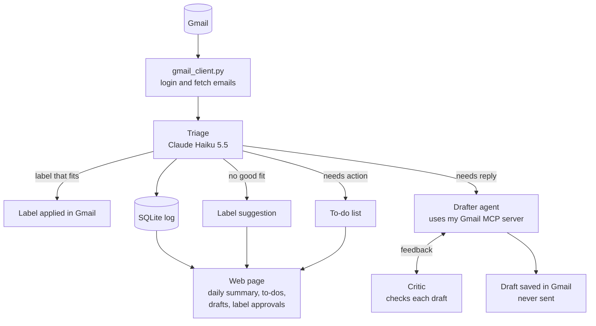

# Inbox Agent

An AI agent that organizes my Gmail. It sorts every email into labels, flags the emails that need a reply or an action from me, drafts replies, and shows everything on a web page with a daily summary. Several Claude models work together, each with its own job, and nothing is ever sent without my approval.

**Status:** Steps 1 to 3 done. The agent can read my inbox and sort emails with Claude Haiku, as a dry run that changes nothing in Gmail yet. Next: add "needs action" and "Unsorted" to triage.

## How it works



Built so far: `gmail_client.py` and Triage (dry run). Everything else is planned.

| Part | Model | Job |
|---|---|---|
| Triage | Claude Haiku 5.5 | Sorts each email, flags needs reply / needs action. Cheap and fast, because it runs on every email |
| Label Designer (planned) | Claude Opus 5.5 | Reads many emails and suggests labels with descriptions |
| Drafter (planned) | Claude Sonnet 5.5 | An agent that looks up past emails with tools, then writes a reply |
| Critic (planned) | Claude Opus 5.5 | Checks each draft for made-up facts, promises I never made and wrong tone, and sends it back for changes |

## Design decisions

### Who decides what

The agent acts on its own when an action is low-risk and easy to undo. It needs my approval when an action changes how the whole system behaves, and it never does anything that can't be undone.

| Action | Who decides | Why |
|---|---|---|
| Apply a label | Agent alone | Affects one email, easy to undo |
| Flag "needs reply" or "needs action" | Agent alone | It's only information |
| Create a new label | Agent suggests, I approve | Changes how every future email is sorted |
| Draft a reply | Agent alone | It's only a draft |
| Send an email | Never the agent | Can't be undone |

**Why the agent doesn't create labels by itself:** it only sees one email at a time, but a good label covers a pattern across many emails. Letting it create labels freely would lead to near-duplicates ("Job Alerts", "Job Notifications"), each new label would change where future emails go, and anyone who emails me could influence my inbox's structure. Instead, emails that fit no label go to "Unsorted" with a suggested label. The web page groups similar suggestions, and I approve, edit or reject them.

### Safety

- **No send or delete tools.** The agent can label, flag and draft, nothing more. Even if an email tricks the model, it can't send or delete anything.
- **Prompt injection defense.** Anyone can email me, so email content is untrusted. The email goes inside `<email>` tags, and the prompt says to treat everything inside them as content, never as instructions. Triage also has no tools, so the worst a malicious email can do is get itself mislabeled.
- **Least privilege.** The app asks Google only for the permissions the current step needs. Right now that's read-only.
- **Secrets stay out of Git.** The API key (`.env`), the Google app file (`credentials.json`) and my saved login (`token.json`) are all in `.gitignore`.
- **Less data sent to the model.** Triage sends only the sender, subject and preview, not the full email.

### Engineering choices

- **The right model for each job.** Haiku for high-volume sorting, stronger models only where judgment matters.
- **Structured outputs instead of parsing text.** Triage describes the answer it wants as a Pydantic class. The API forces Claude to answer in exactly that shape, and the label field only allows names from the label list, so Claude can't invent a label.
- **Workflow where possible, agent where needed.** In triage, my code decides every step and Claude makes one decision per email (a workflow). The Drafter will be a real agent that decides for itself which tools to use.
- **Gmail code separate from AI code.** All Gmail code is in `gmail_client.py`. That keeps the AI code simple, and it's what will become my Gmail MCP server.
- **My own MCP server instead of a ready-made one.** Community Gmail MCP servers usually include send and delete, and would mean trusting someone else's code with my inbox. My own server only has the tools I choose, and it also works in Claude Desktop.
- **Gmail filters and the agent work together.** My filters already sort job alerts by sender address. The agent catches the ones the filters miss by recognizing what an email is, not just who sent it.
- **Label descriptions are the prompt.** The model only knows what a label means from its description, so fixing wrong labels usually means rewriting descriptions.
- **A log of every decision (planned).** A SQLite database will record what the agent did to each email. It means no email is processed twice, and it provides the daily summary, an undo for any label, and data for measuring accuracy.

## Progress log

### Step 1: First call to Claude
- **Built:** `hello_claude.py` sends Claude a sample email and asks for a category, whether it needs a reply, and why.
- **Learned:** what an API call contains (model, system prompt, messages, effort), why the reply comes as a list of blocks, and how tokens determine cost.
- **Result:** correct answer ("Friends, needs reply") for about $0.002.

### Step 2: Connect to Gmail
- **Built:** `gmail_client.py` holds all the Gmail code (login, fetching emails, converting them into a simple `Email` object). `show_inbox.py` prints the 20 newest inbox emails.
- **Learned:** how OAuth login works (my password never reaches the app; it gets an access token and a refresh token, saved in `token.json`), scopes, and the Gmail API's two-step pattern (list email IDs, then fetch each email's details).
- **Notes:** while the Google app is in testing mode, Google ends the login every 7 days. The code notices and opens the browser to sign in again.

### Step 3: Triage (dry run)
- **Built:** `triage.py` sorts the 20 newest emails into 7 starter labels with Claude Haiku 5.5, and flags which need a reply. It only prints the results.
- **Learned:** structured outputs with Pydantic, system prompts versus user messages, effort levels, and prompt injection.
- **Result:** 20 emails sorted for $0.0026, about 13 cents per 1,000 emails. Every label was sensible. None were marked as needing a reply, which is correct, because all 20 were automated emails.
- **Found:** two similar career-advice newsletters got different labels ("Job Alerts" and "Promotions"), because neither description said where newsletters belong. This led to the decision that label descriptions need care, and that the agent should suggest labels rather than create them.
- **Ideas from review:** a "needs action" flag for emails that need me to do something rather than reply (sign a contract, verify an account), and an "Unsorted" label with suggestions for emails that fit no label.

## What's left

- [x] **Step 1:** First call to Claude
- [x] **Step 2:** Connect to Gmail
- [x] **Step 3:** Triage (dry run)
- [ ] **Triage upgrade:** add `needs_action` with what to do, and "Unsorted" with a suggested label name and description
- [ ] **Step 4, labels:** read my existing Gmail labels (including my Indeed and LinkedIn Job Alerts filters), move labels and descriptions into `labels.json`, have the Label Designer suggest a starting set, then apply labels in Gmail and log every decision in SQLite
- [ ] **Step 5:** my own Gmail MCP server, with tools to read emails and save drafts but none to send or delete. Test it in Claude Desktop
- [ ] **Step 6:** the Drafter agent and the Critic
- [ ] **Step 7:** web page with a daily summary, to-do list, drafted replies and label suggestions, and a way to run the agent every day
- [ ] **Step 8:** accuracy tests (evals), README polish and a demo video

**Open questions**
- Where should LinkedIn and Indeed emails that aren't job alerts go (career newsletters, "who viewed your profile")?
- Should the daily run happen automatically each morning (Windows Task Scheduler) or when I open the web page?

## Project files

| File | What it does |
|---|---|
| `hello_claude.py` | Step 1: first call to Claude |
| `gmail_client.py` | All Gmail code: login, fetch emails |
| `show_inbox.py` | Step 2: prints the 20 newest inbox emails |
| `triage.py` | Step 3: sorts emails with Claude Haiku (dry run) |
| `requirements.txt` | Python packages, with exact versions |
| `.env.example` | Template for the API key file |

Not in Git: `.env` (API key), `credentials.json` (Google app file), `token.json` (saved Gmail login), `.venv/` (Python environment).

## Setup

1. Install Python 3.13.
2. Create a virtual environment and install the dependencies:
   ```
   py -3.13 -m venv .venv
   .venv\Scripts\activate
   pip install -r requirements.txt
   ```
3. Copy `.env.example` to `.env` and paste in your API key from the Claude Console.
4. In Google Cloud Console, turn on the Gmail API, set up the OAuth consent screen with yourself as a test user, and create a **Desktop app** OAuth client. Save its JSON file as `credentials.json` in the project folder.
5. Run `python hello_claude.py` to check the Claude connection.
6. Run `python show_inbox.py` to sign in to Gmail and list your 20 newest emails.
7. Run `python triage.py` to see which label Claude would give each of those emails, and which ones need a reply. Nothing in Gmail changes.
